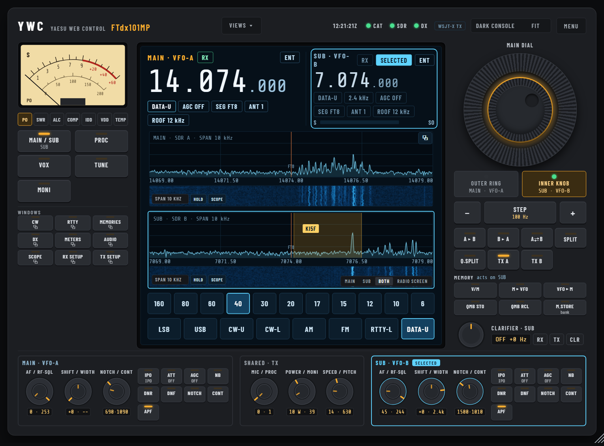
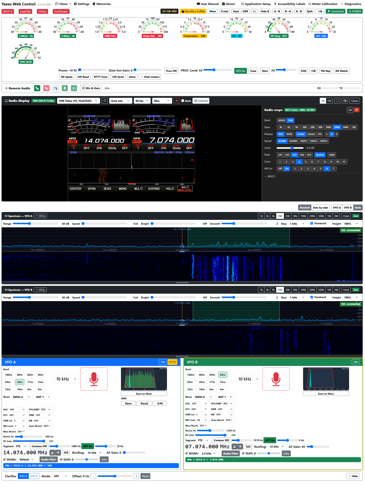

# Yaesu Web Control

Yaesu Web Control (YWC) runs a Yaesu HF transceiver from a browser on your PC, tablet or phone: frequency, mode, meters, a live spectrum and waterfall, CW, RTTY, DX spots and voice control. It is free and open source, and it runs on your own PC or Raspberry Pi with no account and no cloud service.

**[Download the latest installer](https://github.com/mm5agm/Yaesu_Web_Control/releases/latest)** | [User manual](USER_MANUAL.md) | [Discussions](https://github.com/mm5agm/Yaesu_Web_Control/discussions) | [Website](https://mm5agm.co.uk)

## Why this application exists

I wrote YWC because I can't see the FTdx101MP's controls without using a magnifying glass. The Classic page was written specifically with partially sighted operators in mind, so that they can operate the radio with a screen reader and voice control. Everything else has grown from there.

## What it does

**Four views of the radio**

- **[Classic](USER_MANUAL.md#5-main-control-panel)**: everything on one page, made for [NVDA and Windows Narrator](USER_MANUAL.md#16-accessibility-and-screen-readers), with [voice control](USER_MANUAL.md#17-voice-control), [spoken announcements](USER_MANUAL.md#516-voice-announcements), High Contrast mode and labels you can rename in any language.
- **[Radio panel](USER_MANUAL.md#523-radio-panel)**: laid out like the front of the radio, with working keys, knobs and a main dial, in several themes.
- **[Experimental UI](USER_MANUAL.md#522-experimental-ui)**: a workspace of dockable panels, by Fabio Valente (CR7CDC).
- **[RTTY Contest](USER_MANUAL.md#524-rtty-contest)**: only what a contest RTTY operator uses, on one screen. *Still being tested.*

**See the band**

- **[SDR spectrum and waterfall](USER_MANUAL.md#63-sdr-spectrum-display)** from an SDR on the radio's IF output, one per receiver on an FTdx101. Spans run from 1 kHz to 2 MHz, the IF passband is drawn on the trace, and a click tunes to the signal. Please read the [SDR safety warning](#sdr-safety) first.
- **[Radio Display](USER_MANUAL.md#19-radio-display)**: the radio's own screen in the browser, captured from its DVI-D socket with an HDMI-to-USB stick. Click a signal to tune to it, and click the readouts and soft-buttons, with the radio's [scope controls](USER_MANUAL.md#194-cat-scope-controls) beside it. By Fabio. Please read the [DVI-D safety warning](#dvi-d-safety) first, and set the radio's EXT MONITOR PIXEL menu to 800x600.
- **[DX spots](USER_MANUAL.md#517-dx-spots-list)** on the spectrum, and a [watch list](USER_MANUAL.md#514-dx-watch-panel) that alerts you when a callsign or prefix appears.

**Operate**

- **[CW Reader](USER_MANUAL.md#20-cw-reader)** prints the Morse in the radio's receive audio as text, with no extra hardware. On a strong, clean signal it is close to perfect. On a marginal one it prints plausible rubbish, so the status line says what it is actually hearing, nothing is corrected or hidden, and the log form offers a callsign rather than filling it in.
- **[CW Send](USER_MANUAL.md#21-cw-send)**: type a line, press Enter, and the radio keys it. Only the CAT cable is needed.
- **[CW Paddle](USER_MANUAL.md#23-cw-paddle)** sends from your own paddle when the radio is somewhere else, through a HaliKey MIDI or an ESP32-S3 board and three wires. *Still being tested.*
- **[RTTY tuner](USER_MANUAL.md#22-rtty)**: a crossed-ellipse tuning scope and text decode. RTTY is receive only: transmit from your logger, or from MMTTY.
- **[Remote Audio](USER_MANUAL.md#18-remote-audio)**: receive audio in the browser's speakers, and the browser's microphone into the radio. By Fabio. For your own network or a VPN.
- **[Voice control](USER_MANUAL.md#17-voice-control)**: hold the mic button and say the band, mode or frequency. Recognition runs locally, with no cloud service. Windows only.
- **[Memory banks](USER_MANUAL.md#8-radio-memories)** with ADIF import, **[pop-out windows](USER_MANUAL.md#521-pop-out-windows)** for a second monitor, and **[WSJT-X, Log4OM, JTAlert and GridTracker](USER_MANUAL.md#9-external-applications)** alongside.

## ✨ Added since the last release

> **v2.5.4 brings RTTY Contest and the CW Paddle.** **RTTY Contest** is a screen for RTTY contesting: the frequency, band keys, the spectrum over the waterfall and the tuner with its decoded text, every part of it able to go to a window of its own on another monitor. Bruce VK2RT asked for it and tested it through sixteen pre-releases. The **CW Paddle** sends CW from your own paddle when you operate the radio remotely, through a HaliKey or an ESP32-S3 board you program from the page. The Radio panel's CW window has the memory keyer, and YWC can switch the radio off when it closes. Everything is written up in the [v2.5.4 notes](#2026-11-03---v254).

**Since v2.5.4** — in the code, not yet in a full release:

Nothing yet.

What was new in v2.5.3 is in its [release notes](RELEASE_HISTORY.md#2026-10-16---v253).

## 🔧 Fixed since the last release

One line per fix, newest first, with the build that has it. A pre-release installs exactly like a release and carries everything before it; each one is written up under [Release Notes](#release-notes). *Not yet in a build* means the fix is in the code and will be in the next pre-release or release.

Nothing since v2.5.4 yet. Everything fixed in the v2.5.4 pre-releases is in [v2.5.4](#2026-11-03---v254).

## Supported transceivers

| Transceiver | Power | Receivers | Notes |
|-------------|-------|-----------|-------|
| FTdx101MP | 200 W | Dual | All features supported |
| FTdx101D | 100 W | Dual | All features supported |
| FTdx10 | 100 W | Single | Two VFOs; no rear-panel IF output for spectrum |
| FT-710 | 100 W | Single | Two VFOs; no rear-panel IF output for spectrum |
| FTDX3000 | 100 W | Single | Two VFOs; no memory tag (MT) command |
| FT-991A | 100 W (50 W on 2 m / 70 cm) | Single | HF + 6 m + 2 m + 70 cm; C4FM; new in v2.5.3 — built from the 991A's CAT manual and still being tested on a real radio |
| FTDX5000MP | 200 W | Dual | New — available to test; power meter calibration still being refined |
| FTDX5000D | 200 W | Dual | New — available to test; power meter calibration still being refined |

I own and test on the **FTdx101MP**. The other models are built from Yaesu's published CAT documentation and confirmed by the people who own them.

**If your Yaesu isn't listed, I'll gladly add it, and all it takes from you is ordinary operating, not programming.** Use your radio normally with YWC and tell me what happens on the [Discussions tab](https://github.com/mm5agm/Yaesu_Web_Control/discussions). Now and then I may ask you to try a pre-release, or to send a log: the Diagnostics page has **Start fresh test log** and **Download test log** for that.

**FTX-1:** a user has it working on HF with the model set to *FTdx10*. A dedicated profile is on the way once someone can help confirm its 6 m, 2 m and 70 cm memory handling.

## Feedback

I operate FT8 on an FTdx101MP with an SDRplay RSP1B/RSP1, so that's the combination that actually gets tested, and new features from here depend on what other operators ask for. If you use another mode, radio or SDR, even a one-line "works fine" or "this is annoying because..." on the [Discussions tab](https://github.com/mm5agm/Yaesu_Web_Control/discussions) tells me something I can't find out on my own. Tablet testing has been limited, so feedback from tablet users is particularly welcome.

## Platforms

| | **Windows** (shipped installer) | **macOS** (CAT-only DMG) | **Linux** (CAT-only host) |
|---|---|---|---|
| How to run | Download installer from [Releases](https://github.com/mm5agm/Yaesu_Web_Control/releases) | Download DMG from [Releases](https://github.com/mm5agm/Yaesu_Web_Control/releases) (unsigned; arm64 or x64), or `dotnet run --framework net10.0` | `dotnet run --framework net10.0`, or **Docker** (`ghcr.io/mm5agm/yaesu_web_control`, amd64 + arm64 / Pi) |
| Host UI | System tray | Menu-bar status item | Console only (Docker / from source) |
| CAT + browser UI | Yes | Yes | Yes |
| SDR spectrum | Yes | No | No |
| Voice Control (SAPI) | Yes | No | No |
| Voice announcements (browser TTS) | Yes | Yes | Yes |
| CW Reader | Yes | Yes | Yes |
| CW Send (keyboard keying via the radio's keyer) | Yes | Yes | Yes |
| Remote Audio (RX to browser, mic to radio) | Yes | Yes | Yes (native host; not Docker) |
| Radio Display (HDMI capture of the radio's screen) | Yes | Yes | Yes (map `/dev/video*` in Docker) |
| Serial port | `COM3`, … | `/dev/cu.*` | `/dev/ttyUSB*` / `/dev/ttyACM*` |
| USB serial driver | [Silicon Labs CP210x VCP](https://www.silabs.com/software-and-tools/usb-to-uart-bridge-vcp-drivers?tab=downloads) on **Windows, macOS, and Linux** — **reboot after install** |
| User data | `%APPDATA%\MM5AGM\Yaesu Web Control\` | `~/.config/MM5AGM/Yaesu Web Control/` | Same `~/.config/…` path; Docker uses `./data/ywc` volume |
| Auto-exit when no browser | Default on | Default on — turn **off** for headless | Default on from source; Docker forces off |

The macOS DMG is **not notarized** (no Apple Developer Program membership). Gatekeeper will warn on first open — right-click → **Open**, or use **Privacy & Security → Open Anyway**. Same class of warning as the unsigned Windows installer.

Full operational detail: [USER_MANUAL.md §1](USER_MANUAL.md#1-introduction), [§2.2 macOS DMG](USER_MANUAL.md#22-macos-dmg), [§2.4 USB serial driver](USER_MANUAL.md#24-usb-serial-driver-windows--macos--linux), and [§15.10](USER_MANUAL.md#1510-whats-different-on-macos--linux-vs-windows).

Before first CAT use on any OS: install the Silicon Labs driver from the link above and reboot the host.

Build commands for all four targets are in [docs/BUILDING.md](docs/BUILDING.md).

## ⚠️ Windows Security Warnings on First Install

The installer is not code-signed (a signing certificate is a recurring cost I haven't taken on for a free program), so Windows and antivirus tools treat it as an unknown, newly downloaded executable and may warn about it or block it. This is expected — the installer is built by GitHub Actions directly from the source in this repository, and GitHub shows a SHA-256 digest beside each file on the release page — run `Get-FileHash Yaesu_Web_Control_Setup.exe` in PowerShell and the two should match. Follow whichever of these matches what you see:

**Microsoft Defender quarantines the download, or the installed program on first launch, and says "This program is dangerous and executes commands from an attacker"**
This is Defender's cloud/machine-learning classifier (the detection name ends in `!ml` — with v2.5.1 it was `Trojan:Win32/Wacatac.C!ml` on the installed `Yaesu_Web_Control.dll`, and it arrived with a definition update the day after release). It is a false positive that hits many unsigned .NET applications, it can appear on a build that scanned clean the day before, and the installer itself usually scans clean because the file it objects to is inside. To recover: open **Windows Security → Virus & threat protection → Protection history**, click the entry, choose **Actions → Allow on device**, then either download the installer again or simply start YWC again if it was the installed program that was taken. Choose *Allow*, not just *Restore* — Restore puts the file back but Defender may take it again at the next scan. Don't switch Defender off — allowing this one file is enough. If this happens to you, please post the detection name shown in Protection history in a Discussion; I report each one to Microsoft as a false positive, and that is what makes it stop happening for the next person.

**Norton (or other antivirus) flags the file as malware**
This is the same false positive, caused by the executable being unsigned and newly downloaded. In Norton, go to **Security → History**, find the quarantined file, and choose **Restore & Exclude** (or the equivalent Allow option in your antivirus).

**"Windows protected your PC" (SmartScreen) or an Unknown Publisher prompt when you run the installer**
Click **More info → Run anyway**.

**Right-click → Properties → Unblock**
Windows marks files downloaded from the internet as untrusted. Before running the installer, right-click the file, choose **Properties**, and if you see an **Unblock** checkbox at the bottom of the General tab, tick it and click OK.

**"This app can't run on your PC" — Smart App Control**
If Smart App Control is enabled it will block unsigned apps entirely. Go to **Settings → Privacy & Security → Windows Security → App & Browser Control → Smart App Control** and switch it to **Off**, then restart your PC and try again.

The screenshot below shows the Smart App Control setting:

These are one-time steps — once the app is installed you won't see them again.

## Safety

This software interacts with radio hardware. I have used only the official Yaesu CAT commands as per the manual, however, you use entirely at your own risk. Please read the licence. Always verify transmit frequencies, power levels, and settings before use.

### SDR safety

An SDR receiver's front end is **extremely sensitive** and can be **destroyed by even a small amount of TX RF**.

- **FTdx101MP / FTdx101D / FTDX3000** (have IF output): connect the SDR to the rear-panel **IF OUT** RCA socket only. This is an internal low-level signal — safe during TX. Do **not** connect to an antenna port.
- **FTdx10 / FT-710** (no IF output): if you connect an SDR to an antenna port you **must** disconnect it during TX, or use a dedicated receive-only antenna well away from your TX antenna, or fit a T/R relay or PIN-diode T/R switch in front of the SDR. Transmitting with the SDR coax wired directly to your TX antenna will damage the SDR.
- In all cases, an antenna physically close to your TX antenna can still couple enough RF into the SDR to damage it. When in doubt, disconnect.

YWC also shows this warning on the Settings page when an SDR is configured, and a more prominent danger banner appears if your selected radio is an FTdx10 or FT-710.

**Devices:** SDRplay RSP1 / RSP1A / RSP1B / RSP2 / RSPdx / RSPduo through the SDRplay API
(installed separately from [sdrplay.com](https://www.sdrplay.com/downloads/)); RTL-SDR,
Airspy and HackRF through the bundled SoapySDR drivers, which need no separate install and
which I have not tested myself - feedback welcome.

The full span list, why two SDRs rather than one RSPduo, why an SDRplay rather than a £25
RTL-SDR dongle, and what the brief pause on a span change is, are in
[USER_MANUAL.md §6.3](USER_MANUAL.md#63-sdr-spectrum-display).

### DVI-D safety

The DVI-D socket on these radios is not a standard-conforming HDMI source, and not every passive DVI-D-to-HDMI adapter is safe on every Yaesu: there are community investigations of damaged radios. YWC does not supply, protect or vouch for any cable or capture device, and the chain from the radio's socket to the PC is your responsibility. [My own look at the question](https://www.youtube.com/watch?v=dtlziYEsXxE) is worth watching before you plug anything in, and the cable and stick I use on my own FTdx101MP are in [§19](USER_MANUAL.md#19-radio-display). They are not a guarantee for your radio. There is also a [video of the feature in action](https://www.youtube.com/watch?v=1EY7m5e91TI).

## Privacy

Yaesu Web Control runs on your own PC and does not send your data anywhere. It makes only these network connections:

- Between your browser and the PC it runs on, on your own network, for the web interface.
- From your browser to GitHub (api.github.com), to see whether a newer release exists. It reads the release list; nothing about you or your station is sent. See [GitHub's privacy statement](https://docs.github.com/site-policy/privacy-policies/github-general-privacy-statement).
- To a DX cluster, only if you turn DX spots on and enter a cluster yourself. It logs in with the callsign you enter, as every DX cluster requires.

## Staying informed about updates

YWC shows a banner the first time you run it after a new release. On a full release it only ever tells you about another full release. On a pre-release it also tells you about newer pre-releases. Neither offers a nightly `unstable-` build. Full detail: [§5.1](USER_MANUAL.md#51-top-bar).

To hear about a release outside the app:

- **GitHub:** on [the repository page](https://github.com/mm5agm/Yaesu_Web_Control), choose **Watch**, then **Custom**, and tick only **Releases**.
- **RSS / Atom:** subscribe to https://github.com/mm5agm/Yaesu_Web_Control/releases.atom in your feed reader.

## Contributors

YWC is mostly my own work, but I'm grateful for the community contributions that have improved it:

- **Fabio Valente (CR7CDC)** — by now a good deal more than a contributor. The whole of **Radio Display** — HDMI capture of the radio's screen, the docked CAT scope controls, the Linux and Docker capture path — is his ([#97](https://github.com/mm5agm/Yaesu_Web_Control/pull/97), [#117](https://github.com/mm5agm/Yaesu_Web_Control/pull/117), [#120](https://github.com/mm5agm/Yaesu_Web_Control/pull/120)). So is **Remote Audio** ([#92](https://github.com/mm5agm/Yaesu_Web_Control/pull/92), [#112](https://github.com/mm5agm/Yaesu_Web_Control/pull/112)), and so is the entire **macOS / Linux / Docker** side — the CAT-only host, the macOS app and menu-bar item, the Dockerfile and multi-architecture image, and the release pipeline that builds them all. I did none of that; I tested it on a Raspberry Pi 3B ([#90](https://github.com/mm5agm/Yaesu_Web_Control/pull/90), [#133](https://github.com/mm5agm/Yaesu_Web_Control/pull/133), [#134](https://github.com/mm5agm/Yaesu_Web_Control/pull/134)). He also cut the CAT polling and persistence overhead and scaled the power meter to each radio's own rating ([#122](https://github.com/mm5agm/Yaesu_Web_Control/pull/122)), kept both VFO panels live on single-receiver radios ([#119](https://github.com/mm5agm/Yaesu_Web_Control/pull/119)), set up the daily `unstable` snapshot builds ([#115](https://github.com/mm5agm/Yaesu_Web_Control/pull/115)), and earlier contributed the keyboard transmit shortcut and split-mode fixes ([#79](https://github.com/mm5agm/Yaesu_Web_Control/pull/79)), FTdx10 roofing-filter support ([#80](https://github.com/mm5agm/Yaesu_Web_Control/pull/80)) and the single-receiver VFO routing fixes ([#81](https://github.com/mm5agm/Yaesu_Web_Control/pull/81)).

---

## Release Notes

**Only the version you are installing is listed here.** Earlier releases are in
[RELEASE_HISTORY.md](RELEASE_HISTORY.md); their installers are still on the
[releases page](https://github.com/mm5agm/Yaesu_Web_Control/releases).

## 2026-11-03 - v2.5.4

*RTTY Contest, a screen for RTTY contesting, and the CW Paddle, for sending CW from your own paddle when you operate remotely. Everything in the v2.5.4 pre-releases is included; their notes are in [RELEASE_HISTORY.md](RELEASE_HISTORY.md). Install it over v2.5.3 or any pre-release; your settings are kept.*

**RTTY Contest** *(still being tested)* - pick it from **Views** on the Radio panel, or go to `/rtty-contest`. [§5.24](USER_MANUAL.md#524-rtty-contest)

- **One screen:** the frequency, mode, Mark/Shift and compact meters along the top, band keys for MAIN and SUB that go to each band's RTTY spot, the spectrum over the waterfall, and the RTTY tuner with its decoded text. Bruce VK2RT asked for it, and his testing shaped almost everything on it.
- **MODE** holds the radio in RTTY-L, RTTY-U, DATA-L or DATA-U, and turns amber when the radio is in some other mode. In DATA-L and DATA-U the spectrum is centred on the passband, and Auto tunes the mark onto your Mark.
- **A tuning dial** under the tuner, in a box headed VFO WHEEL, that spins like a weighted knob. **DECODE** swaps it for the decoded text.
- **MEM** lists your memories, and a click tunes the receiver on screen to one. **MONI** switches the radio's monitor on and off and sets its level.
- **PWR and WIDTH are kept for each band**, and a band key puts them back. **AUTO** beside WIDTH goes back to the starting width.
- **CAT SET** sends the CAT commands you keep in Settings under RTTY setup, with lines for each band.
- **FIXED** holds the spectrum still while the dial moves, and turns a page at the edge. **SPAN** includes 30 and 40 kHz.
- **Pop-outs and layouts:** the spectrum, the waterfall, the tuner, the dial and the decoded text each go into a window of their own, and **LAYOUT** saves all of it by name. The page has its own theme list, and VIEWS and MENU keys by its title.
- Receive has been tested on an FTdx101MP and an FTdx101D. RTTY Contest is receive only: transmit from your logger, or from MMTTY.

**CW Paddle** *(new and still being tested)* [§23](USER_MANUAL.md#23-cw-paddle)

- **Send CW from your own paddle** when you operate the radio remotely. The paddle goes into a USB adapter that shows up as a MIDI device: a **HaliKey MIDI**, or an **ESP32-S3 board** that you program from the page with one button. The keyer and sidetone run in the browser, and YWC keys the radio by DTR on its Standard COM port.
- **Dry run at every start**, so you can practise without transmitting. Choosing a key line can put the radio in transmit at once, so have a dummy load or be ready to be on the air.
- **What you send shows in the CW Send log**, on lines tagged *paddle*, beside what you type.
- **HTTPS**, an option in Settings, lets a browser on another computer use the MIDI adapter.
- Tested on an FTdx101MP with an ESP32-S3 adapter. At the radio, plug the paddle into its KEY jack as usual.

**Radio panel** [§5.23](USER_MANUAL.md#523-radio-panel)

- **The CW window has the memory keyer**: M1 to M5 with their messages, and **SAVE**. **BREAK-IN is a key** that steps OFF → SEMI → FULL, and the mouse wheel steps SPEED and PITCH.
- **The pop-out spectrum window tunes on a click or the mouse wheel**, with a readout of the frequency under the mouse.
- **A corner grip scales the panel** to any size, and the main dial spins like a weighted knob. Idea from the tuning dial in Brian Clark's IC-7300-Scope.
- DATA-L and RTTY-U mode keys, and a window's key brings it to the front when it is popped out.

**Everywhere else**

- **The CW Reader has a Save button**, and prints less junk between overs.
- **Turn the radio off when YWC closes**, a new setting under Settings > Radio connection, off by default.
- **Hide spectrum on the Classic page.** A button above the spectrum folds it away; it also folds by itself while no SDR is streaming.
- **IDD and VDD meters on every model.** The FTdx10, FT-710 and FTDX5000 had them hidden.
- **Open YWC on the page you want** from a shortcut: add `rtty-contest`, `radio`, `classic`, `experimental` or `settings` after the program in its Target.
- **Voice control no longer clips the first word after a pause.**
- **radio_state.json is not rewritten when nothing has changed**, which saves writes to a Raspberry Pi's SD card.

**Fixed**

- Memories recalled to SUB on the FTdx101 set MAIN's IF width, shift, roofing filter, NB, NR, AGC and antenna instead of SUB's.
- The SWR needle on the Radio panel jumped to full scale on a good aerial while sending CW.
- In the CW Reader, a slow sender heard straight after fast or fading signals had the callsign broken up ("I W 2 B TA" for IW2BTA).
- Holding down a TX toggle key that is also a shortcut letter ran that shortcut on every key repeat, so the radio was retuned while you transmitted.
- The Mic Gain slider didn't follow MIC GAIN turned on the radio ([#228](https://github.com/mm5agm/Yaesu_Web_Control/issues/228)).
- A Radio panel window popped out to its own browser window drew and then never updated.
- Radio panel: CW BREAK-IN showed FULL after you set SEMI.
- The readout of the frequency under the mouse went stale while the dial moved.
- A pop-out window on a screen too short for it never kept its size.
