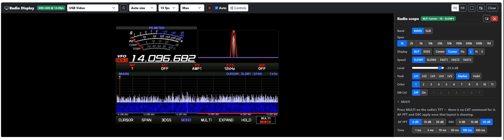
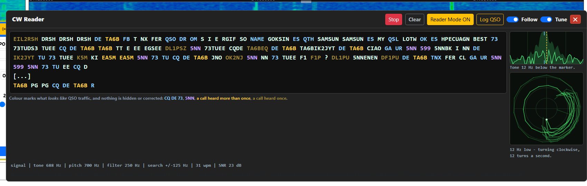
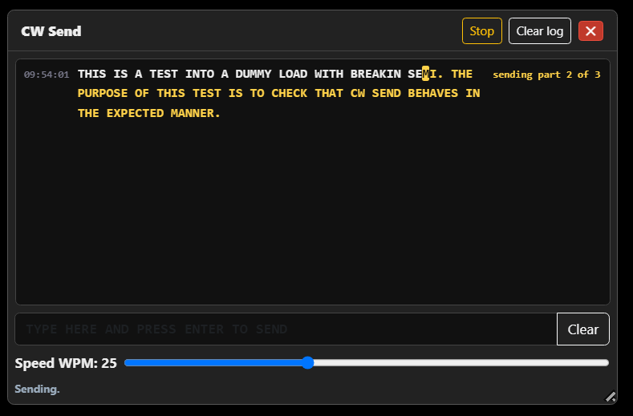
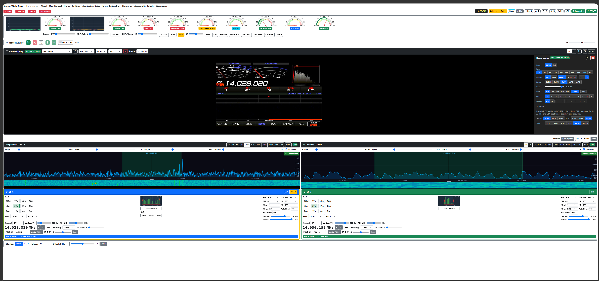
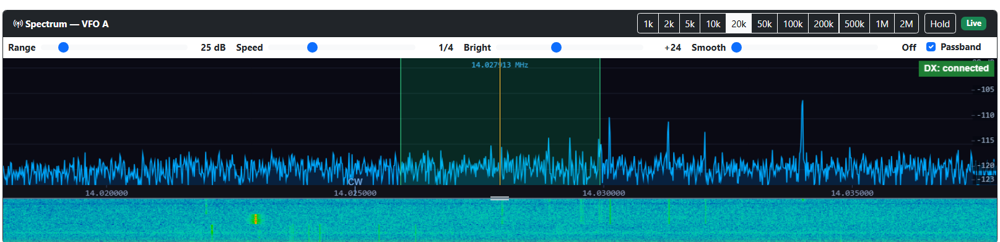

# Yaesu Web Control

> **Feedback wanted — especially if your setup isn't mine.** I operate FT8 on an FTdx101MP with an SDRplay RSP1B/RSP1 for the spectrum display, so that's the combination that actually gets tested. YWC now does everything I personally need, which means I've run out of my own ideas for what to add next — new features from here on depend on what other operators ask for. If you use another mode (SSB, CW, RTTY, other digital modes), another supported radio (FTdx101D, FTdx10, FT-710, FTDX3000), or a different SDR, even a one-line "works fine" or "this is annoying because…" on the [Discussions tab](https://github.com/mm5agm/Yaesu_Web_Control/discussions) tells me something I can't find out on my own. Bug reports, layout issues, and feature requests are all equally welcome.

## ✨ Added since the last release

> **v2.5.4 brings RTTY Contest and the CW Paddle.** **RTTY Contest** is a screen for RTTY contesting: the frequency, band keys, the spectrum over the waterfall and the tuner with its decoded text, every part of it able to go to a window of its own on another monitor. Bruce VK2RT asked for it and tested it through sixteen pre-releases. The **CW Paddle** sends CW from your own paddle when you operate the radio remotely, through a HaliKey or an ESP32-S3 board you program from the page. The Radio panel's CW window has the memory keyer, and YWC can switch the radio off when it closes. Everything is written up in the [v2.5.4 notes](#2026-11-03---v254).

**Since v2.5.4** — in the code, not yet in a full release:

Nothing yet.

**New in v2.5.4:**

- **RTTY Contest, a new GUI for RTTY contesting** *(still being tested)*. Only what a contest RTTY operator uses, on one screen: the frequency, band keys for MAIN and SUB, the spectrum over the waterfall, and the RTTY tuner docked at the side with its decoded text. A tuning dial, MEM for your memories, MONI, PWR and WIDTH kept for each band, FIXED to hold the spectrum still, and CAT SET to send your own RTTY setup string. Each part pops out into a window of its own, and named layouts put every window back on its own monitor. Bruce VK2RT asked for it and tested it. RTTY Contest is receive only: transmit from your logger, or from MMTTY. [§5.24](USER_MANUAL.md#524-rtty-contest).
- **CW Paddle: send CW from your own paddle** *(new and still being tested)*. The paddle goes into a USB adapter that shows up as a MIDI device. That can be a **HaliKey MIDI**, or an **ESP32-S3 board** that you program from the page with one button. The ESP32 boards are cheap and sold everywhere, while the HaliKey is hard to get outside the USA. The keyer and sidetone run in the browser, on the shack PC or anywhere on your network, and YWC keys the radio by DTR on its Standard COM port. What you send shows in the CW Send log beside what you type. It is for operating the radio remotely: at the radio, plug the paddle into its KEY jack as usual. The page starts in dry run, so you can practise without transmitting. **CW Paddle** is in the top bar, and under MENU on the Radio panel and RTTY Contest. [§23](USER_MANUAL.md#23-cw-paddle).
- **The RTTY Tuner** keeps **From radio** and **Auto** in its heading, so **Tones only** keeps them, and its arms no longer lean when the signal is on tune, so mark and space straighten at the same dial setting (on Bruce's FTdx101D they were 50 Hz apart). Mark and Shift are kept by YWC, so every window starts from the last tones used. [§22](USER_MANUAL.md#22-rtty).
- **The Radio panel's CW window has the memory keyer** (M1 to M5, with SAVE), and **BREAK-IN is a key** that steps OFF → SEMI → FULL. The mouse wheel steps SPEED and PITCH. [§5.23](USER_MANUAL.md#523-radio-panel).
- **The pop-out spectrum window tunes on a click or the mouse wheel**, with a readout of the frequency under the mouse, and has the panel's SCOPE settings on each pane. **A corner grip scales the Radio panel** to any size, and its main dial spins like a weighted knob. [§5.23](USER_MANUAL.md#523-radio-panel).
- **30 kHz and 40 kHz spans** fill the jump from 20 to 50.
- **The CW Reader has a Save button** that saves the decoded text to a file, and prints less junk between overs.
- **Turn the radio off when YWC closes**, a new setting under Settings > Radio connection, off by default.
- **Hide spectrum on the Classic page**, and **IDD and VDD meters on every model**.
- **Open YWC on the page you want from a shortcut**: `rtty-contest`, `radio`, `classic`, `experimental` or `settings` after the program in its Target.

What was new in v2.5.3 is in its [release notes](RELEASE_HISTORY.md#2026-10-16---v253).

**v2.5.0 was the biggest release since the SDR spectrum display arrived.** Five things are in it that were not in v2.4.2 at all: the radio's own screen in the browser — and you can click it — a Morse reader, a Morse sender, remote audio both ways, and YWC running on macOS, Linux and a Raspberry Pi. Two of those are Fabio Valente's (CR7CDC) work, and this release is as much his as mine.

### The radio's own screen in the browser — and you can click it

The FTdx101, FTdx10 and FT-710 repeat their front-panel TFT on a rear DVI-D socket. Plug that into a cheap HDMI-to-USB capture stick and YWC shows the radio's screen — scope, 3DSS, meters, menus, all of it — in the browser, popped out into its own window, or on a tablet in another room. That part is Fabio's, start to finish.

**It is not a static picture of the radio.** HDMI capture is one-way, so a click can never reach the touchscreen — instead YWC works out what is under the mouse and sends the CAT command for it. On the FTdx101MP/D and the FTdx10 in MONO W/F:

- **Hover over the scope or the waterfall** to read the frequency under the cursor, and **click to tune there**. The frequency is measured from the radio's own VFO marker line, so it is right whatever the span is set to.
- **Click the ANT / ATT / IPO / R.FIL / AGC readouts** to cycle them, exactly as you would on the radio itself.
- **Click the CURSOR / SPAN / 3DSS / HOLD soft-buttons** along the bottom of the screen.
- Where a soft-button has no CAT command behind it (MONO, MULTI, EXPAND, MEM CH) the label says so rather than doing nothing silently. The overlay assumes EXPAND is off: with it on the scope grows up over the readout row, and the radio does not report that over CAT.

Docked to the right of the picture is a **Controls** column that drives the radio's own scope over CAT — centre/cursor/fix, 3DSS or waterfall, span, speed, level, peak, marker, hold, colour, and the AF-FFT and oscilloscope settings. Turn a knob on the front panel and the button in the browser follows. On the FTdx101 both the MAIN and SUB scopes are driven, and with no capture stick at all the same controls are still there as a **Radio Scope** card.

Two videos: [what the radio's DVI-D output actually is, and what can go wrong connecting it to HDMI](https://www.youtube.com/watch?v=dtlziYEsXxE) — worth watching before you plug anything in — and [the feature in action](https://www.youtube.com/watch?v=1EY7m5e91TI). **Set the radio's EXT MONITOR PIXEL menu to 800×600 first**, or the capture stick silently stretches the picture. The FT-710 has no clickable overlay yet. Full detail: [§19](USER_MANUAL.md#19-radio-display) and [§19.4](USER_MANUAL.md#194-cat-scope-controls).

### CW Reader — the Morse on the air, as text

A **CW Read** button on the main page opens a reader that decodes the Morse in the radio's receive audio and prints it as text. No extra hardware, nothing transmitted. Neither Yaesu nor Icom hand their own decoder's output over CAT, so I wrote a decoder; it lives in the shared [Radio_Web_Control_Core](https://github.com/mm5agm/Radio_Web_Control_Core) and the identical code reads Morse in Icom Web Control.

The status line says what it is actually hearing — signal or not, the tone against your pitch, the filter width, the SNR, how far off pitch the station is — and when two stations are inside the filter, or the tone is breaking up, it says so and prints nothing rather than guessing. **Reader Mode** sets the radio up for copy (CW, a narrow filter, APF on) and puts your own settings back when you stop; **ZIN** drops the station onto your pitch; **Tune** shows the passband with a pitch marker and a zero-beat figure. Every session writes a timestamped transcript, and the log form *offers* the callsign and report the reader thinks it saw as one-click suggestions rather than filling them in — a callsign quietly filled in from junk is worse than an empty box. Confirmed contacts append to a plain ADIF file. Windows, macOS, Linux and Docker. Full detail: [§20](USER_MANUAL.md#20-cw-reader).

### CW Send — type a line, press Enter, the radio keys it

The reader's other half. A **CW Send** button opens a box: type a line, press **Enter**, and the radio keys it. Nothing goes out until Enter, so you can type ahead or paste, and the character being keyed is highlighted as it goes out. Only the CAT cable is needed, so it runs everywhere the reader does.

It is built on the radio's own keyer memories: the line is cut into pieces of up to 50 characters at word boundaries, each written to keyer memory 5 and played, and your own M5 is put back at the end. With break-in **Off** the line goes to the monitor with a banner and nothing is transmitted, which is how I test it. **Stop** — or **Escape** — drops everything not yet started; the piece already on the air finishes, because the radio cannot be told to abandon a playback, which is the reason it is sent in pieces at all. Lines typed while one is sending are queued. Full detail: [§21](USER_MANUAL.md#21-cw-send).

### And the rest of v2.5.0

- **Remote Audio** (Fabio) — the radio's receive audio in the browser's speakers and the browser's microphone into the radio's USB audio for transmit, with a pop-out player and device pickers that find the radio's USB CODEC for you. For your own LAN or a VPN: YWC has no login, so don't port-forward it.
- **macOS, Linux and Docker** (Fabio) — an unsigned macOS app for Apple Silicon and Intel, and a multi-architecture Docker image that runs on a Raspberry Pi 3B.
- **Signals are drawn where they really are on the FTdx101 spectrum.** The IF OUT sockets are not at the SDR's centre and the radio slides its IF with the filter settings; YWC ignored both, so everything was drawn 5–7 kHz out. Measured and corrected on both receivers.
- **The span buttons are now the radio's own list** — 1k to 1M, plus 2M. Everything from 100 kHz down is a software zoom of a fixed stream, so stepping between 1k and 100k is instant: no retune, no blank trace.
- **The receiver's passband is shaded on the trace**, moving with IF width, shift and CW pitch, so you can see which of the signals on screen you are actually hearing.
- **Smooth is a slider now, and the default no longer buries CW** — the old fixed average took about 11 dB off a one-bin CW carrier.
- **The keyer's M1–M5 buttons finally send.** They had done nothing since v1.6.0: they used the command that *plays* a memory to try to *load* one. **Monitor level** had never worked either. Both fixed.
- **Meters** — the SWR needle no longer freezes or dips ([#124](https://github.com/mm5agm/Yaesu_Web_Control/issues/124)), the FTdx101's front-panel meter pair is yours again outside transmit, and RF power is scaled to each radio's own rating instead of the FTdx101MP's 200 W.
- **A keyboard-reachable ATU Tune button** and tuner voice commands, **CTCSS that works** (six separate faults), and **one screen-reader announcement per action** instead of an unpredictable number.
- **The log is a tenth of the size**, with **Start fresh test log** / **Download test log** on the Diagnostics page, so a bug report can carry just the part that matters.

Every one of these is written up in full in the [release notes](RELEASE_HISTORY.md#2026-09-14---v250) at the foot of this page.

## 🔧 Fixed since the last release

One line per fix, newest first, with the build that has it. A pre-release installs exactly like a release and carries everything before it; each one is written up under [Release Notes](#release-notes). *Not yet in a build* means the fix is in the code and will be in the next pre-release or release.

Nothing since v2.5.4 yet. Everything fixed in the v2.5.4 pre-releases is in [v2.5.4](#2026-11-03---v254).

**Supported transceivers:**

| Transceiver | Power | Receivers | Notes |
|-------------|-------|-----------|-------|
| FTdx101MP | 200 W | Dual | All features supported |
| FTdx101D | 100 W | Dual | All features supported |
| FTdx10 | 100 W | Single | Two VFOs; no rear-panel IF output for spectrum |
| FT-710 | 100 W | Single | Two VFOs; no rear-panel IF output for spectrum |
| FTDX3000 | 100 W | Single | Two VFOs; no memory tag (MT) command |
| FT-991A | 100 W (50 W on 2 m / 70 cm) | Single | HF + 6 m + 2 m + 70 cm; C4FM; new in v2.5.3 — built from the 991A's CAT manual and still being tested on a real radio |
| FTDX5000MP | 200 W | Dual | New — available to test; power meter calibration still being refined |
| FTDX5000D | 200 W | Dual | New — available to test; power meter calibration still being refined |

## Getting your Yaesu radio added — it's easier than you think

I own and test on the **FTdx101MP**; the other supported models are built from Yaesu's published CAT documentation and confirmed by the users who own them. If your Yaesu isn't listed yet — the **FTX-1** and others are all realistic — I'll gladly add it, and **all it takes from you is ordinary operating, not programming.**

"Testing" just means *using your radio normally* with YWC and telling me what happens: change bands, tune around, switch modes, key up, and drop a note on the [Discussions tab](https://github.com/mm5agm/Yaesu_Web_Control/discussions) like *"frequency and mode track fine, but the S-meter reads a bit low."* **No code, no build tools, no command line.** If you can run the installer and operate your rig, you can test — I do the programming, you just tell me what your radio does. Even a one-liner on a model that already works ("works fine on my FT-710") is useful: it tells me which radios have real users behind them.

**What it might involve.** Now and then I'll ask you to try a **pre-release** — a test build with a fix in it, installed exactly like a normal release — and, if something's misbehaving, to send me a **log file** so I can see what your radio and YWC actually did. YWC makes that easy: open the **Diagnostics page** (in the menu across the top of YWC), click **Start fresh test log**, do the test, then **Download test log** — you get a small log of just that test to **drag straight into the GitHub discussion or issue**. (The full logs also live on disk at `%APPDATA%\MM5AGM\Yaesu Web Control\logs\ywc-<date>.log` if you ever need them directly.) That's genuinely the whole job: install, operate, and occasionally send a file across.

**FTX-1:** a user has reported it working on HF (run with the model set to *FTdx10*) — frequency and mode track cleanly and quickly. Its 6m/2m/70cm memory handling still needs a little work, so a dedicated FTX-1 profile is on the way once someone can help confirm the VHF/UHF side. If you own an FTX-1, I'd love to hear from you.

### Platforms (Windows vs macOS / Linux)

| | **Windows** (shipped installer) | **macOS** (CAT-only DMG) | **Linux** (CAT-only host) |
|---|---|---|---|
| How to run | Download installer from [Releases](https://github.com/mm5agm/Yaesu_Web_Control/releases) | Download DMG from [Releases](https://github.com/mm5agm/Yaesu_Web_Control/releases) (unsigned; arm64 or x64), or `dotnet run --framework net10.0` | `dotnet run --framework net10.0`, or **Docker** (`ghcr.io/mm5agm/yaesu_web_control`, amd64 + arm64 / Pi) |
| Host UI | System tray | Menu-bar status item | Console only (Docker / from source) |
| CAT + browser UI | Yes | Yes | Yes |
| SDR spectrum | Yes | No | No |
| Voice Control (SAPI) | Yes | No | No |
| Voice announcements (browser TTS) | Yes | Yes | Yes |
| CW Reader | Yes | Yes | Yes |
| CW Send (keyboard keying via the radio's keyer) | Yes | Yes | Yes |
| Remote Audio (RX to browser, mic to radio) | Yes | Yes | Yes (native host; not Docker) |
| Radio Display (HDMI capture of the radio's screen) | Yes | Yes | Yes (map `/dev/video*` in Docker) |
| Serial port | `COM3`, … | `/dev/cu.*` | `/dev/ttyUSB*` / `/dev/ttyACM*` |
| USB serial driver | [Silicon Labs CP210x VCP](https://www.silabs.com/software-and-tools/usb-to-uart-bridge-vcp-drivers?tab=downloads) on **Windows, macOS, and Linux** — **reboot after install** |
| User data | `%APPDATA%\MM5AGM\Yaesu Web Control\` | `~/.config/MM5AGM/Yaesu Web Control/` | Same `~/.config/…` path; Docker uses `./data/ywc` volume |
| Auto-exit when no browser | Default on | Default on — turn **off** for headless | Default on from source; Docker forces off |

The macOS DMG is **not notarized** (no Apple Developer Program membership). Gatekeeper will warn on first open — right-click → **Open**, or use **Privacy & Security → Open Anyway**. Same class of warning as the unsigned Windows installer.

Full operational detail: [USER_MANUAL.md §1](USER_MANUAL.md#1-introduction), [§2.2 macOS DMG](USER_MANUAL.md#22-macos-dmg), [§2.4 USB serial driver](USER_MANUAL.md#24-usb-serial-driver-windows--macos--linux), and [§15.10](USER_MANUAL.md#1510-whats-different-on-macos--linux-vs-windows).

Before first CAT use on any OS: install the Silicon Labs driver from the link above and reboot the host.

### Building from source (developers)

Build commands for all four targets - the Windows product, the CAT-only host,
the macOS DMG and the Linux/Docker image - are in [docs/BUILDING.md](docs/BUILDING.md).

## What it looks like

Everything on one page: the meters across the top, the radio's own screen captured
over HDMI with the CAT scope controls docked to its right, both SDR spectrum panels
underneath, and a VFO card for each receiver.

One SDR panel at the 20 kHz span. The shaded band is the receiver's IF passband, the
amber line is the dial, and a click on a CW signal lands on it.

The VOX, CW Keyer and FM Repeater panels, open together.

## ⚠️ Warning

This software interacts with radio hardware. I have used only the official Yaesu CAT commands as per the manual, however, you use entirely at your own risk. Please read the licence. Always verify transmit frequencies, power levels, and settings before use.

---

## 📖 Why This Application Exists
I wrote this application because I can't see the FTdx101MP controls without using a magnifying glass. I've added support for partially sighted users by utilising NVDA and windows narrator. As a ham who uses WSJT-X, JTAlert, and Log4OM, I thought it would be nice to add buttons to start them from the app as it saves openning up the individual programs. I've added memory channel banks and functions to read and save etc. You don't need to save to the transceiver unless you specifically want them on it, taking your transceiver to another location for example. Please read the settings carefully as you can overwrite the transceivers memories.  

Tablet testing has been limited — feedback from tablet users is particularly welcome.

---

## ⚠️ Windows Security Warnings on First Install

The installer is not code-signed (a signing certificate is a recurring cost I haven't taken on for a free program), so Windows and antivirus tools treat it as an unknown, newly downloaded executable and may warn about it or block it. This is expected — the installer is built by GitHub Actions directly from the source in this repository, and GitHub shows a SHA-256 digest beside each file on the release page — run `Get-FileHash Yaesu_Web_Control_Setup.exe` in PowerShell and the two should match. Follow whichever of these matches what you see:

**Microsoft Defender quarantines the download, or the installed program on first launch, and says "This program is dangerous and executes commands from an attacker"**
This is Defender's cloud/machine-learning classifier (the detection name ends in `!ml` — with v2.5.1 it was `Trojan:Win32/Wacatac.C!ml` on the installed `Yaesu_Web_Control.dll`, and it arrived with a definition update the day after release). It is a false positive that hits many unsigned .NET applications, it can appear on a build that scanned clean the day before, and the installer itself usually scans clean because the file it objects to is inside. To recover: open **Windows Security → Virus & threat protection → Protection history**, click the entry, choose **Actions → Allow on device**, then either download the installer again or simply start YWC again if it was the installed program that was taken. Choose *Allow*, not just *Restore* — Restore puts the file back but Defender may take it again at the next scan. Don't switch Defender off — allowing this one file is enough. If this happens to you, please post the detection name shown in Protection history in a Discussion; I report each one to Microsoft as a false positive, and that is what makes it stop happening for the next person.

**Norton (or other antivirus) flags the file as malware**
This is the same false positive, caused by the executable being unsigned and newly downloaded. In Norton, go to **Security → History**, find the quarantined file, and choose **Restore & Exclude** (or the equivalent Allow option in your antivirus).

**"Windows protected your PC" (SmartScreen) or an Unknown Publisher prompt when you run the installer**
Click **More info → Run anyway**.

**Right-click → Properties → Unblock**
Windows marks files downloaded from the internet as untrusted. Before running the installer, right-click the file, choose **Properties**, and if you see an **Unblock** checkbox at the bottom of the General tab, tick it and click OK.

**"This app can't run on your PC" — Smart App Control**
If Smart App Control is enabled it will block unsigned apps entirely. Go to **Settings → Privacy & Security → Windows Security → App & Browser Control → Smart App Control** and switch it to **Off**, then restart your PC and try again.

The screenshot below shows the Smart App Control setting:

These are one-time steps — once the app is installed you won't see them again.

---

## Privacy

Yaesu Web Control runs on your own PC and does not send your data anywhere. It makes only these network connections:

- Between your browser and the PC it runs on, on your own network, for the web interface.
- From your browser to GitHub (api.github.com), to see whether a newer release exists. It reads the release list; nothing about you or your station is sent. See [GitHub's privacy statement](https://docs.github.com/site-policy/privacy-policies/github-general-privacy-statement).
- To a DX cluster, only if you turn DX spots on and enter a cluster yourself. It logs in with the callsign you enter, as every DX cluster requires.

---

## 📡 Spectrum display with an SDR

A real-time spectrum and waterfall, fed by an SDR connected to the transceiver's 9 MHz
IF output. On the dual-receiver FTdx101MP and FTdx101D, **two SDRs** can be used, one per
VFO. Spans run from 1 kHz to 2 MHz, the receiver's IF passband is drawn on the trace, and
a click tunes the VFO to the signal under the pointer.

> ## ⚠️ SDR safety — read before connecting
>
> An SDR receiver's front end is **extremely sensitive** and can be **destroyed by even a small amount of TX RF**.
>
> - **FTdx101MP / FTdx101D / FTDX3000** (have IF output): connect the SDR to the rear-panel **IF OUT** RCA socket only. This is an internal low-level signal — safe during TX. Do **not** connect to an antenna port.
> - **FTdx10 / FT-710** (no IF output): if you connect an SDR to an antenna port you **must** disconnect it during TX, or use a dedicated receive-only antenna well away from your TX antenna, or fit a T/R relay or PIN-diode T/R switch in front of the SDR. Transmitting with the SDR coax wired directly to your TX antenna will damage the SDR.
> - In all cases, an antenna physically close to your TX antenna can still couple enough RF into the SDR to damage it. When in doubt, disconnect.
>
> YWC also shows this warning on the Settings page when an SDR is configured, and a more prominent danger banner appears if your selected radio is an FTdx10 or FT-710.

**Devices:** SDRplay RSP1 / RSP1A / RSP1B / RSP2 / RSPdx / RSPduo through the SDRplay API
(installed separately from [sdrplay.com](https://www.sdrplay.com/downloads/)); RTL-SDR,
Airspy and HackRF through the bundled SoapySDR drivers, which need no separate install and
which I have not tested myself - feedback welcome.

The full span list, why two SDRs rather than one RSPduo, why an SDRplay rather than a £25
RTL-SDR dongle, and what the brief pause on a span change is, are in
[USER_MANUAL.md §6.3](USER_MANUAL.md#63-sdr-spectrum-display).

## 📝 CW Reader and ⌨️ CW Send

**CW Read** listens to the radio's receive audio and prints the Morse as text. It needs no
extra hardware, never transmits, and works on Windows, macOS, Linux and Docker alike.
**Reader Mode** is one button that sets the radio up the way the decoder wants it and puts
your mode, width and APF back when you stop; **ZIN** puts the station on your CW pitch.
Every session writes a timestamped transcript, and confirmed contacts append to a plain
ADIF file.

**I want to be honest about what a Morse decoder is.** On a strong, clean, machine-sent
signal it is close to perfect. On a marginal one it prints plausible-looking rubbish that
looks exactly like good copy, and it has no idea which it is doing - in my own testing it
reported full confidence on nearly six hundred characters of complete junk. So the status
line says what it is actually seeing rather than guessing, nothing is corrected or hidden,
and the log form offers a callsign as a button to click rather than filling it in for you.

**CW Send** is the other half: type a line, press Enter, and the radio keys it - no key, no
keyer interface, no extra audio, only the CAT cable. No Yaesu has a "send this text"
command, so the line goes out through keyer memory 5 in pieces of up to 50 characters at
word boundaries. The wait between pieces is Morse timing worked out from the text and the
keyer speed, because I measured the radio's "playback finished" flag through a whole
message on the air and it never once asserted. With break-in off the line plays to the
monitor and nothing goes on the air.

The decoder itself lives in [Radio_Web_Control_Core](https://github.com/mm5agm/Radio_Web_Control_Core),
shared with Icom Web Control, because a Morse decoder does not know what a radio is - and
not one line of it had to change to read Morse off a different brand.

Full detail: [§20 CW Reader](USER_MANUAL.md#20-cw-reader) and
[§21 CW Send](USER_MANUAL.md#21-cw-send).

## 📺 Radio Display - the radio's own screen in the browser

**This feature is Fabio Valente's (CR7CDC) work, not mine.** He designed it, wrote it and
carried it through three pull requests ([#97](https://github.com/mm5agm/Yaesu_Web_Control/pull/97),
[#117](https://github.com/mm5agm/Yaesu_Web_Control/pull/117),
[#120](https://github.com/mm5agm/Yaesu_Web_Control/pull/120)); I tested it on my FTdx101MP
and made a couple of suggestions.

The FTdx101, FTdx10 and FT-710 repeat their front-panel TFT on a DVI-D socket. Radio Display
captures it with an ordinary HDMI-to-USB stick and shows it in the browser, with the radio's
own scope controls docked beside it over CAT. Nothing is transmitted and nothing on the radio
is changed by the capture.

> **Electrical safety.** The DVI-D socket on these radios is not a standard-conforming HDMI source, and not every passive DVI-D-to-HDMI adapter is safe on every Yaesu — there are community investigations of damaged radios. YWC does not supply, protect or vouch for any cable or capture device; the chain from the radio's socket to the PC is your responsibility. The investigation video above is my own look at the question; the cable and card above are what I run on my own FTdx101MP and are not a guarantee for yours.

The cable and capture stick I use, the two explanatory videos, the 800x600 setting the radios
all need, and the Docker mapping are in
[USER_MANUAL.md §19 Radio Display](USER_MANUAL.md#19-radio-display).

## Project direction

The summer of 2026 went into three big pieces: the **CW Reader**, and two that are Fabio Valente's (CR7CDC) work — **Radio Display** and **Remote Audio**, and the whole of running YWC **outside Windows** (macOS, Linux, Docker on a Raspberry Pi); my part in those was testing on my FTdx101MP and a Raspberry Pi 3B. Together they mean the radio can now be operated, heard and *seen* from a browser anywhere on the network. What comes next depends on what people ask for — see the note at the top of this page. **Voice control** remains a first-class accessibility feature for partially sighted and blind operators — hands-free band changes, frequency entry, mode switching, and rig status without needing to see the screen.

**Voice control v1 shipped in v2.4.0-pre1 (2026-06-24)** and has been extended through the v2.4.0 pre-release series, most recently with independent per-VFO control (separate mic buttons for VFO A and VFO B) and a full Voice Language Pack Manager for editing phrases and macros. It uses **Windows' built-in speech recognition (SAPI 5 / `System.Speech`)** running locally on the user's PC, driven by an editable phrase pack tuned to ham-radio vocabulary, with a press-and-hold microphone button beside each VFO panel — the command targets whichever VFO's button you're holding (single-receiver radios show only one button). Recognised audio never leaves the PC; no cloud account, no public endpoint, no DNS or tunnel setup. A microphone connected to the PC is the only hardware requirement. See [USER_MANUAL.md §17 Voice Control](USER_MANUAL.md#17-voice-control) for what voice does, the full command list, and how to enable it. Feedback from real users is what's wanted right now — please try it and report back.

**On the abandoned Amazon Alexa route:** an earlier proof of concept routed voice through an Echo device over a Cloudflare tunnel into YWC. It worked end-to-end including signature verification, but setting it up required the user to own a domain, run a Cloudflare account, configure a custom Alexa Skill in the Amazon Developer Console, and install `cloudflared` — well over an hour of fiddly setup for the average ham. The local-SAPI approach above is dramatically simpler (one Windows speech-pack install, one Settings toggle) and runs entirely offline. The Alexa branch is therefore retired; the local mic approach is the supported path going forward.

## Staying informed about updates

Recent versions of YWC include an in-app update check that pops up a banner the first time you run it after a new release lands, listing what has changed. If you're already running v2.2.x or later you'll get those notifications automatically — no action needed.

**What it offers you depends on which build you are running.** On a **full release** the banner only ever tells you about another full release: pre-releases are deliberately left out, so if you don't go looking for one you will never be told it exists, and there is no setting that changes that. On a **pre-release** — anything with a `-pre` in its name — it also tells you when a newer pre-release arrives, marked **Pre-release** so you can see what you're being offered, because being kept up to date is the whole point of testing one. Neither ever offers you a nightly `unstable-` build. Full detail: [§5.1](USER_MANUAL.md#51-top-bar).

If you're on an older version that pre-dates the update check, or you want to know about a new release before you've launched the app, **any one of these will keep you in the loop**:

- **GitHub release notifications** (most reliable, free, no spam):
  1. Make sure you're signed in to GitHub
  2. Visit https://github.com/mm5agm/Yaesu_Web_Control
  3. Click the **Watch** dropdown at the top-right of the page
  4. Choose **Custom** and tick only **Releases**
  5. Save — you'll get one email per release, and nothing in between

- **RSS / Atom feed** — if you use a feed reader (Feedly, NewsBlur, Inoreader, Thunderbird, etc.), subscribe to https://github.com/mm5agm/Yaesu_Web_Control/releases.atom — new releases appear in your reader without any account or email signup.

If you're talking to another Yaesu operator running an older YWC, **a heads-up that a new version exists is the most reliable way it reaches them**. Word of mouth still works — there's no email list of all downloaders and no way to reach the very early users who don't fall into any of the channels above.

---

## Contributors

YWC is mostly my own work, but I'm grateful for the community contributions that have improved it:

- **Fabio Valente (CR7CDC)** — by now a good deal more than a contributor. The whole of **Radio Display** — HDMI capture of the radio's screen, the docked CAT scope controls, the Linux and Docker capture path — is his ([#97](https://github.com/mm5agm/Yaesu_Web_Control/pull/97), [#117](https://github.com/mm5agm/Yaesu_Web_Control/pull/117), [#120](https://github.com/mm5agm/Yaesu_Web_Control/pull/120)). So is **Remote Audio** ([#92](https://github.com/mm5agm/Yaesu_Web_Control/pull/92), [#112](https://github.com/mm5agm/Yaesu_Web_Control/pull/112)), and so is the entire **macOS / Linux / Docker** side — the CAT-only host, the macOS app and menu-bar item, the Dockerfile and multi-architecture image, and the release pipeline that builds them all. I did none of that; I tested it on a Raspberry Pi 3B ([#90](https://github.com/mm5agm/Yaesu_Web_Control/pull/90), [#133](https://github.com/mm5agm/Yaesu_Web_Control/pull/133), [#134](https://github.com/mm5agm/Yaesu_Web_Control/pull/134)). He also cut the CAT polling and persistence overhead and scaled the power meter to each radio's own rating ([#122](https://github.com/mm5agm/Yaesu_Web_Control/pull/122)), kept both VFO panels live on single-receiver radios ([#119](https://github.com/mm5agm/Yaesu_Web_Control/pull/119)), set up the daily `unstable` snapshot builds ([#115](https://github.com/mm5agm/Yaesu_Web_Control/pull/115)), and earlier contributed the keyboard transmit shortcut and split-mode fixes ([#79](https://github.com/mm5agm/Yaesu_Web_Control/pull/79)), FTdx10 roofing-filter support ([#80](https://github.com/mm5agm/Yaesu_Web_Control/pull/80)) and the single-receiver VFO routing fixes ([#81](https://github.com/mm5agm/Yaesu_Web_Control/pull/81)).

---

## Release Notes

**Only the version you are installing is listed here.** Earlier releases are in
[RELEASE_HISTORY.md](RELEASE_HISTORY.md); their installers are still on the
[releases page](https://github.com/mm5agm/Yaesu_Web_Control/releases).

## 2026-11-03 - v2.5.4

*RTTY Contest, a screen for RTTY contesting, and the CW Paddle, for sending CW from your own paddle when you operate remotely. Everything in the v2.5.4 pre-releases is included; their notes are in [RELEASE_HISTORY.md](RELEASE_HISTORY.md). Install it over v2.5.3 or any pre-release; your settings are kept.*

**RTTY Contest** *(still being tested)* - pick it from **Views** on the Radio panel, or go to `/rtty-contest`. [§5.24](USER_MANUAL.md#524-rtty-contest)

- **One screen:** the frequency, mode, Mark/Shift and compact meters along the top, band keys for MAIN and SUB that go to each band's RTTY spot, the spectrum over the waterfall, and the RTTY tuner with its decoded text. Bruce VK2RT asked for it, and his testing shaped almost everything on it.
- **MODE** holds the radio in RTTY-L, RTTY-U, DATA-L or DATA-U, and turns amber when the radio is in some other mode. In DATA-L and DATA-U the spectrum is centred on the passband, and Auto tunes the mark onto your Mark.
- **A tuning dial** under the tuner, in a box headed VFO WHEEL, that spins like a weighted knob. **DECODE** swaps it for the decoded text.
- **MEM** lists your memories, and a click tunes the receiver on screen to one. **MONI** switches the radio's monitor on and off and sets its level.
- **PWR and WIDTH are kept for each band**, and a band key puts them back. **AUTO** beside WIDTH goes back to the starting width.
- **CAT SET** sends the CAT commands you keep in Settings under RTTY setup, with lines for each band.
- **FIXED** holds the spectrum still while the dial moves, and turns a page at the edge. **SPAN** includes 30 and 40 kHz.
- **Pop-outs and layouts:** the spectrum, the waterfall, the tuner, the dial and the decoded text each go into a window of their own, and **LAYOUT** saves all of it by name. The page has its own theme list, and VIEWS and MENU keys by its title.
- Receive has been tested on an FTdx101MP and an FTdx101D. RTTY Contest is receive only: transmit from your logger, or from MMTTY.

**CW Paddle** *(new and still being tested)* [§23](USER_MANUAL.md#23-cw-paddle)

- **Send CW from your own paddle** when you operate the radio remotely. The paddle goes into a USB adapter that shows up as a MIDI device: a **HaliKey MIDI**, or an **ESP32-S3 board** that you program from the page with one button. The keyer and sidetone run in the browser, and YWC keys the radio by DTR on its Standard COM port.
- **Dry run at every start**, so you can practise without transmitting. Choosing a key line can put the radio in transmit at once, so have a dummy load or be ready to be on the air.
- **What you send shows in the CW Send log**, on lines tagged *paddle*, beside what you type.
- **HTTPS**, an option in Settings, lets a browser on another computer use the MIDI adapter.
- Tested on an FTdx101MP with an ESP32-S3 adapter. At the radio, plug the paddle into its KEY jack as usual.

**Radio panel** [§5.23](USER_MANUAL.md#523-radio-panel)

- **The CW window has the memory keyer**: M1 to M5 with their messages, and **SAVE**. **BREAK-IN is a key** that steps OFF → SEMI → FULL, and the mouse wheel steps SPEED and PITCH.
- **The pop-out spectrum window tunes on a click or the mouse wheel**, with a readout of the frequency under the mouse.
- **A corner grip scales the panel** to any size, and the main dial spins like a weighted knob. Idea from the tuning dial in Brian Clark's IC-7300-Scope.
- DATA-L and RTTY-U mode keys, and a window's key brings it to the front when it is popped out.

**Everywhere else**

- **The CW Reader has a Save button**, and prints less junk between overs.
- **Turn the radio off when YWC closes**, a new setting under Settings > Radio connection, off by default.
- **Hide spectrum on the Classic page.** A button above the spectrum folds it away; it also folds by itself while no SDR is streaming.
- **IDD and VDD meters on every model.** The FTdx10, FT-710 and FTDX5000 had them hidden.
- **Open YWC on the page you want** from a shortcut: add `rtty-contest`, `radio`, `classic`, `experimental` or `settings` after the program in its Target.
- **Voice control no longer clips the first word after a pause.**
- **radio_state.json is not rewritten when nothing has changed**, which saves writes to a Raspberry Pi's SD card.

**Fixed**

- Memories recalled to SUB on the FTdx101 set MAIN's IF width, shift, roofing filter, NB, NR, AGC and antenna instead of SUB's.
- The SWR needle on the Radio panel jumped to full scale on a good aerial while sending CW.
- In the CW Reader, a slow sender heard straight after fast or fading signals had the callsign broken up ("I W 2 B TA" for IW2BTA).
- Holding down a TX toggle key that is also a shortcut letter ran that shortcut on every key repeat, so the radio was retuned while you transmitted.
- The Mic Gain slider didn't follow MIC GAIN turned on the radio ([#228](https://github.com/mm5agm/Yaesu_Web_Control/issues/228)).
- A Radio panel window popped out to its own browser window drew and then never updated.
- Radio panel: CW BREAK-IN showed FULL after you set SEMI.
- The readout of the frequency under the mouse went stale while the dial moved.
- A pop-out window on a screen too short for it never kept its size.
