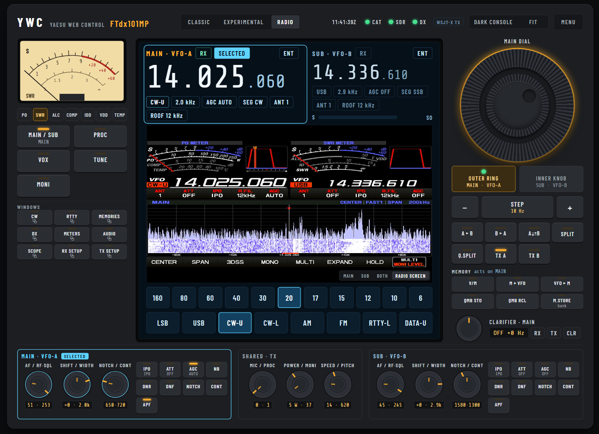
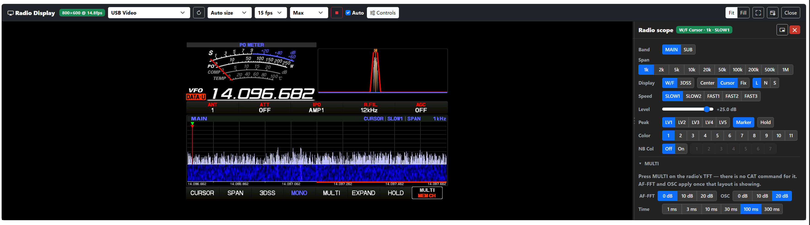
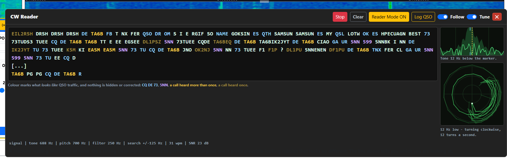
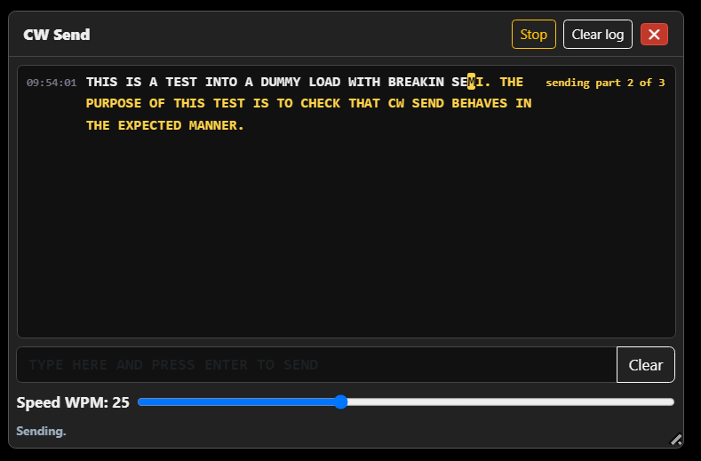
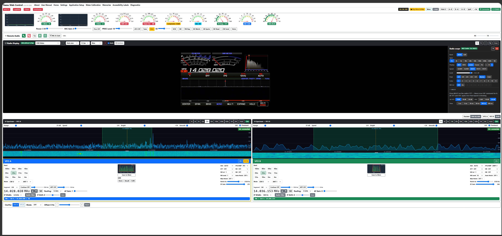
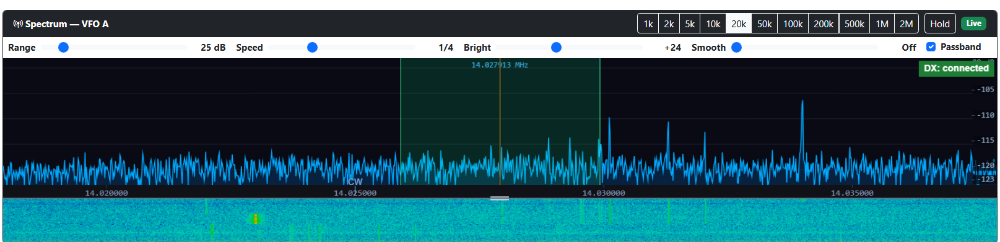

# Yaesu Web Control

> **Feedback wanted — especially if your setup isn't mine.** I operate FT8 on an FTdx101MP with an SDRplay RSP1B/RSP1 for the spectrum display, so that's the combination that actually gets tested. YWC now does everything I personally need, which means I've run out of my own ideas for what to add next — new features from here on depend on what other operators ask for. If you use another mode (SSB, CW, RTTY, other digital modes), another supported radio (FTdx101D, FTdx10, FT-710, FTDX3000), or a different SDR, even a one-line "works fine" or "this is annoying because…" on the [Discussions tab](https://github.com/mm5agm/Yaesu_Web_Control/discussions) tells me something I can't find out on my own. Bug reports, layout issues, and feature requests are all equally welcome.

## ✨ Added since the last release

> **v2.5.3 brings two new ways of working the radio.** Fabio Valente's (CR7CDC) **Experimental UI** is a dark workspace of panels you can drag, dock, tab together and save as named layouts. The **Radio panel** is laid out like the front of a transceiver, with keys, knobs and a main dial that work, both receivers on the FTdx101, and windows for CW, RTTY, memories and the rest. The Classic page is unchanged and is still where YWC opens. RTTY now prints the text as well as drawing the cross, and its **Auto** button works the settings out from the signal; the CW Reader has an **Auto** button that tunes the station in. Everything is written up in the [v2.5.3 notes](#2026-10-16---v253).

**Since v2.5.3** — in the code, not yet in a full release (first in [v2.5.4-pre1](#2026-10-23---v254-pre1-pre-release), [v2.5.4-pre2](#2026-10-26---v254-pre2-pre-release), [v2.5.4-pre3](#2026-10-26---v254-pre3-pre-release), [v2.5.4-pre4](#2026-10-27---v254-pre4-pre-release), [v2.5.4-pre5](#2026-10-29---v254-pre5-pre-release), [v2.5.4-pre6](#2026-10-29---v254-pre6-pre-release), [v2.5.4-pre7](#2026-10-30---v254-pre7-pre-release) and [v2.5.4-pre8](#2026-10-30---v254-pre8-pre-release)):

- **RTTY Contest, a new GUI for RTTY contesting** *(pre2 to pre4, still being tested)*. Only what a contest RTTY operator uses, on one screen: the frequency, band keys for MAIN and SUB, the spectrum over the waterfall, and the RTTY tuner docked at the side with its decoded text. Each part pops out into a window of its own, and named layouts put every window back on its own monitor. Bruce VK2RT asked for it. [§5.24](USER_MANUAL.md#524-rtty-contest).
- **Three changes from Bruce VK2RT's testing** *(pre5)*. **From radio** and **Auto** are in the RTTY Tuner heading, so **Tones only** keeps them. The scope's arms no longer lean when the signal is on tune, so mark and space straighten at the same dial setting (on Bruce's FTdx101D they were 50 Hz apart). And **FIXED** on RTTY Contest holds the spectrum still while the dial moves.
- **More from Bruce's testing** *(pre6, pre7)*. FIXED fills the spectrum to both edges and holds it until the passband reaches the edge. RTTY Contest has **VIEWS** and **MENU** keys by its title, so Settings is one click away, and the SDR spans include **30 kHz** and **40 kHz**.
- **The CW Reader has a Save button** *(pre7)* that saves the decoded text to a file.
- **Your own RTTY setup string, and settings that stay put** *(pre8)*. A SETUP key on RTTY Contest sends the CAT commands you keep in Settings, with lines for each band. PWR is kept for each band and the WIDTH you set is kept by the tuner. A shortcut can open YWC on RTTY Contest.
- **The Radio panel's CW window has the memory keyer** (M1 to M5, with SAVE), and **BREAK-IN is a key** that steps OFF → SEMI → FULL. The mouse wheel steps SPEED and PITCH. [§5.23](USER_MANUAL.md#523-radio-panel).
- **The pop-out spectrum window tunes on a click or the mouse wheel**, with a readout of the frequency under the mouse, and has the panel's SCOPE settings on each pane. [§5.23](USER_MANUAL.md#523-radio-panel).
- **A corner grip scales the Radio panel** to any size.
- **The CW Reader prints less junk between overs.**

**New in v2.5.3:**

- **An Experimental UI, beside the Classic one** (Fabio Valente, CR7CDC). **Experimental UI** in the top bar opens a dark, dockable workspace: the VFOs, spectrum, meters, Radio Display and the rest are panels you can drag, dock, tab together, resize and pop out, and save as named layouts. [§5.22](USER_MANUAL.md#522-experimental-ui).
- **A Radio panel, laid out like the front of the radio.** **Radio** in the top bar opens a third view at `/radio`: the meter and keys down the left, the VFOs and spectrum in the middle, the main dial on the right and the knobs along the bottom, and they all work - wheel or drag a knob to turn it. On the FTdx101 both receivers are on it, with the dial's outer ring for MAIN and inner knob for SUB. Keys under the meter open windows for CW, RTTY, memories, DX spots, meters, Remote Audio, the radio's scope and RX and TX setup, which can be moved, resized, torn apart and popped out to a second screen. The spectrum can be swapped for the radio's own screen, which can be clicked as on Radio Display. Six colour themes. [§5.23](USER_MANUAL.md#523-radio-panel).

  

- **RTTY: it reads the text now, and works the settings out for you.** The **RTTY Tune** panel has a **Decode** pane beside the crossed figure, which reads the Mark, Shift, Speed and Rev you tuned with. **Auto** listens for about four seconds and fills in all four from the signal, and when it is sure, moves the dial to put the signal in the middle of the radio's filter; when it can't make sense of what it hears, it says so and changes nothing. **From radio** takes the radio's own MARK and SHIFT settings. **Receive only.** Settings → RTTY Tuner says what the tuner may touch. [§22](USER_MANUAL.md#22-rtty).
- **RTTY Contest Mode.** A switch under Settings → RTTY Tuner that trims the panel to the figure and its controls, and holds it still, for contesting with a logger that has its own decoder. Bruce VK2RT asked for it after CQ WW RTTY. [§22.7](USER_MANUAL.md#227-contest-mode-the-tuner-on-its-own).
- **CW Reader Auto.** It finds the station being read, moves the dial so its tone sits on your CW pitch, and sets the filter for the speed it is sending. **Stop** puts your filter back. The reader also re-learns the speed when a new station starts, keeps the first letter on a quiet band, and splits two letters a sender has run together. [§20.6](USER_MANUAL.md#auto-tune-the-station-in-for-you).
- **Pop-out windows for a second monitor.** The CW Reader, CW Send, RTTY Tuner, Audio Filter and DX Spots list can each open in a window of their own with their **↗** button, at any size and on any screen; **Reattach** puts them back. [§5.21](USER_MANUAL.md#521-pop-out-windows).
- **FT-710: the radio's own scope in the spectrum panel, with no SDR** *(experimental - FT-710 owners, please try it)*. With menu SCU-LAN10 switched ON (no unit needed), the FT-710 sends its scope over USB, and YWC can draw it as the spectrum and waterfall. FTDI's driver and LibFT4222 have to be installed separately. It is built on protocol work by the Nexus project and ON8ST, and ut9fj has checked it on receive on a real FT-710. Not yet checked while transmitting. [§6.3](USER_MANUAL.md#63-sdr-spectrum-display).
- **The FT-991A is a model of its own**, with 2m, 70cm and C4FM, instead of being set up as an FT-710. Built from its CAT manual and still being tested on a real radio. [§6.1](USER_MANUAL.md#61-radio-connection).
- **A spectrum panel as tall or short as you want**, **drag the spectrum to tune**, and **hide the VFO panels, the meters and the Clarifier** so the page can be just the spectrum ([#171](https://github.com/mm5agm/Yaesu_Web_Control/discussions/171)). [§5.4](USER_MANUAL.md#54-spectrum-display).
- **CW Send stops within a word or two, and won't send in the wrong mode**, and the **CW break-in delay and Full break-in reach the radio**. [§21](USER_MANUAL.md#21-cw-send), [§5.12](USER_MANUAL.md#512-cw-keyer-panel).
- **Free the SDR when the last browser closes**, a new setting under Settings > SDR, off by default, so another program can use the SDR while YWC is still running.

What was new in v2.5.2 is in its [release notes](RELEASE_HISTORY.md#2026-09-24---v252).

**v2.5.0 was the biggest release since the SDR spectrum display arrived.** Five things are in it that were not in v2.4.2 at all: the radio's own screen in the browser — and you can click it — a Morse reader, a Morse sender, remote audio both ways, and YWC running on macOS, Linux and a Raspberry Pi. Two of those are Fabio Valente's (CR7CDC) work, and this release is as much his as mine.

### The radio's own screen in the browser — and you can click it

The FTdx101, FTdx10 and FT-710 repeat their front-panel TFT on a rear DVI-D socket. Plug that into a cheap HDMI-to-USB capture stick and YWC shows the radio's screen — scope, 3DSS, meters, menus, all of it — in the browser, popped out into its own window, or on a tablet in another room. That part is Fabio's, start to finish.

**It is not a static picture of the radio.** HDMI capture is one-way, so a click can never reach the touchscreen — instead YWC works out what is under the mouse and sends the CAT command for it. On the FTdx101MP/D and the FTdx10 in MONO W/F:

- **Hover over the scope or the waterfall** to read the frequency under the cursor, and **click to tune there**. The frequency is measured from the radio's own VFO marker line, so it is right whatever the span is set to.
- **Click the ANT / ATT / IPO / R.FIL / AGC readouts** to cycle them, exactly as you would on the radio itself.
- **Click the CURSOR / SPAN / 3DSS / HOLD soft-buttons** along the bottom of the screen.
- Where a soft-button has no CAT command behind it (MONO, MULTI, EXPAND, MEM CH) the label says so rather than doing nothing silently. The overlay assumes EXPAND is off: with it on the scope grows up over the readout row, and the radio does not report that over CAT.

Docked to the right of the picture is a **Controls** column that drives the radio's own scope over CAT — centre/cursor/fix, 3DSS or waterfall, span, speed, level, peak, marker, hold, colour, and the AF-FFT and oscilloscope settings. Turn a knob on the front panel and the button in the browser follows. On the FTdx101 both the MAIN and SUB scopes are driven, and with no capture stick at all the same controls are still there as a **Radio Scope** card.

Two videos: [what the radio's DVI-D output actually is, and what can go wrong connecting it to HDMI](https://www.youtube.com/watch?v=dtlziYEsXxE) — worth watching before you plug anything in — and [the feature in action](https://www.youtube.com/watch?v=1EY7m5e91TI). **Set the radio's EXT MONITOR PIXEL menu to 800×600 first**, or the capture stick silently stretches the picture. The FT-710 has no clickable overlay yet. Full detail: [§19](USER_MANUAL.md#19-radio-display) and [§19.4](USER_MANUAL.md#194-cat-scope-controls).

### CW Reader — the Morse on the air, as text

A **CW Read** button on the main page opens a reader that decodes the Morse in the radio's receive audio and prints it as text. No extra hardware, nothing transmitted. Neither Yaesu nor Icom hand their own decoder's output over CAT, so I wrote a decoder; it lives in the shared [Radio_Web_Control_Core](https://github.com/mm5agm/Radio_Web_Control_Core) and the identical code reads Morse in Icom Web Control.

The status line says what it is actually hearing — signal or not, the tone against your pitch, the filter width, the SNR, how far off pitch the station is — and when two stations are inside the filter, or the tone is breaking up, it says so and prints nothing rather than guessing. **Reader Mode** sets the radio up for copy (CW, a narrow filter, APF on) and puts your own settings back when you stop; **ZIN** drops the station onto your pitch; **Tune** shows the passband with a pitch marker and a zero-beat figure. Every session writes a timestamped transcript, and the log form *offers* the callsign and report the reader thinks it saw as one-click suggestions rather than filling them in — a callsign quietly filled in from junk is worse than an empty box. Confirmed contacts append to a plain ADIF file. Windows, macOS, Linux and Docker. Full detail: [§20](USER_MANUAL.md#20-cw-reader).

### CW Send — type a line, press Enter, the radio keys it

The reader's other half. A **CW Send** button opens a box: type a line, press **Enter**, and the radio keys it. Nothing goes out until Enter, so you can type ahead or paste, and the character being keyed is highlighted as it goes out. Only the CAT cable is needed, so it runs everywhere the reader does.

It is built on the radio's own keyer memories: the line is cut into pieces of up to 50 characters at word boundaries, each written to keyer memory 5 and played, and your own M5 is put back at the end. With break-in **Off** the line goes to the monitor with a banner and nothing is transmitted, which is how I test it. **Stop** — or **Escape** — drops everything not yet started; the piece already on the air finishes, because the radio cannot be told to abandon a playback, which is the reason it is sent in pieces at all. Lines typed while one is sending are queued. Full detail: [§21](USER_MANUAL.md#21-cw-send).

### And the rest of v2.5.0

- **Remote Audio** (Fabio) — the radio's receive audio in the browser's speakers and the browser's microphone into the radio's USB audio for transmit, with a pop-out player and device pickers that find the radio's USB CODEC for you. For your own LAN or a VPN: YWC has no login, so don't port-forward it.
- **macOS, Linux and Docker** (Fabio) — an unsigned macOS app for Apple Silicon and Intel, and a multi-architecture Docker image that runs on a Raspberry Pi 3B.
- **Signals are drawn where they really are on the FTdx101 spectrum.** The IF OUT sockets are not at the SDR's centre and the radio slides its IF with the filter settings; YWC ignored both, so everything was drawn 5–7 kHz out. Measured and corrected on both receivers.
- **The span buttons are now the radio's own list** — 1k to 1M, plus 2M. Everything from 100 kHz down is a software zoom of a fixed stream, so stepping between 1k and 100k is instant: no retune, no blank trace.
- **The receiver's passband is shaded on the trace**, moving with IF width, shift and CW pitch, so you can see which of the signals on screen you are actually hearing.
- **Smooth is a slider now, and the default no longer buries CW** — the old fixed average took about 11 dB off a one-bin CW carrier.
- **The keyer's M1–M5 buttons finally send.** They had done nothing since v1.6.0: they used the command that *plays* a memory to try to *load* one. **Monitor level** had never worked either. Both fixed.
- **Meters** — the SWR needle no longer freezes or dips ([#124](https://github.com/mm5agm/Yaesu_Web_Control/issues/124)), the FTdx101's front-panel meter pair is yours again outside transmit, and RF power is scaled to each radio's own rating instead of the FTdx101MP's 200 W.
- **A keyboard-reachable ATU Tune button** and tuner voice commands, **CTCSS that works** (six separate faults), and **one screen-reader announcement per action** instead of an unpredictable number.
- **The log is a tenth of the size**, with **Start fresh test log** / **Download test log** on the Diagnostics page, so a bug report can carry just the part that matters.

Every one of these is written up in full in the [release notes](RELEASE_HISTORY.md#2026-09-14---v250) at the foot of this page.

## 🔧 Fixed since the last release

One line per fix, newest first, with the build that has it. A pre-release installs exactly like a release and carries everything before it; each one is written up under [Release Notes](#release-notes). *Not yet in a build* means the fix is in the code and will be in the next pre-release or release.

| Fixed | Issue | In build |
|---|---|---|
| Pop-out windows: a window on a screen too short for it never kept its size, and opened at the default size every time, which didn't fit either. | - | v2.5.4-pre1 |
| Radio panel and pop-out spectrum: with the mouse held still, the readout of the frequency under it went stale while the dial moved. It now follows the trace. | - | v2.5.4-pre1 |
| A Radio panel window popped out to its own browser window drew and then never updated. It now gets live updates. | - | v2.5.4-pre1 |
| The Mic Gain slider did not follow MIC GAIN turned on the radio's front panel. It now follows, on Classic and the Experimental UI. | [#228](https://github.com/mm5agm/Yaesu_Web_Control/issues/228) | v2.5.4-pre1 |
| Radio panel: CW BREAK-IN showed FULL after you set SEMI, and did not follow a SEMI/FULL change made on the radio. | - | v2.5.4-pre1 |
| Keyboard shortcuts: holding down a TX toggle key that is also a shortcut letter (say j) no longer runs that shortcut on every key repeat, so the radio is not retuned while you transmit. The ? list now names the TX key. | - | v2.5.4-pre1 |
| Radio panel: the SWR needle no longer jumps to full scale on a good aerial while transmitting CW. It ignores readings taken when the radio puts out under 1 W, and averages the rest as the Classic page does. | - | v2.5.4-pre1 |
| CW Reader: a slow sender heard straight after fast or fading signals no longer has his callsign broken into letters ("I W 2 B TA" for IW2BTA). Gaps measured at the old speed are no longer used to judge where words end at the new one. | - | v2.5.4-pre1 |

**Supported transceivers:**

| Transceiver | Power | Receivers | Notes |
|-------------|-------|-----------|-------|
| FTdx101MP | 200 W | Dual | All features supported |
| FTdx101D | 100 W | Dual | All features supported |
| FTdx10 | 100 W | Single | Two VFOs; no rear-panel IF output for spectrum |
| FT-710 | 100 W | Single | Two VFOs; no rear-panel IF output for spectrum |
| FTDX3000 | 100 W | Single | Two VFOs; no memory tag (MT) command |
| FT-991A | 100 W (50 W on 2 m / 70 cm) | Single | HF + 6 m + 2 m + 70 cm; C4FM; new in v2.5.3 — built from the 991A's CAT manual and still being tested on a real radio |
| FTDX5000MP | 200 W | Dual | New — available to test; power meter calibration still being refined |
| FTDX5000D | 200 W | Dual | New — available to test; power meter calibration still being refined |

## Getting your Yaesu radio added — it's easier than you think

I own and test on the **FTdx101MP**; the other supported models are built from Yaesu's published CAT documentation and confirmed by the users who own them. If your Yaesu isn't listed yet — the **FTX-1** and others are all realistic — I'll gladly add it, and **all it takes from you is ordinary operating, not programming.**

"Testing" just means *using your radio normally* with YWC and telling me what happens: change bands, tune around, switch modes, key up, and drop a note on the [Discussions tab](https://github.com/mm5agm/Yaesu_Web_Control/discussions) like *"frequency and mode track fine, but the S-meter reads a bit low."* **No code, no build tools, no command line.** If you can run the installer and operate your rig, you can test — I do the programming, you just tell me what your radio does. Even a one-liner on a model that already works ("works fine on my FT-710") is useful: it tells me which radios have real users behind them.

**What it might involve.** Now and then I'll ask you to try a **pre-release** — a test build with a fix in it, installed exactly like a normal release — and, if something's misbehaving, to send me a **log file** so I can see what your radio and YWC actually did. YWC makes that easy: open the **Diagnostics page** (in the menu across the top of YWC), click **Start fresh test log**, do the test, then **Download test log** — you get a small log of just that test to **drag straight into the GitHub discussion or issue**. (The full logs also live on disk at `%APPDATA%\MM5AGM\Yaesu Web Control\logs\ywc-<date>.log` if you ever need them directly.) That's genuinely the whole job: install, operate, and occasionally send a file across.

**FTX-1:** a user has reported it working on HF (run with the model set to *FTdx10*) — frequency and mode track cleanly and quickly. Its 6m/2m/70cm memory handling still needs a little work, so a dedicated FTX-1 profile is on the way once someone can help confirm the VHF/UHF side. If you own an FTX-1, I'd love to hear from you.

### Platforms (Windows vs macOS / Linux)

| | **Windows** (shipped installer) | **macOS** (CAT-only DMG) | **Linux** (CAT-only host) |
|---|---|---|---|
| How to run | Download installer from [Releases](https://github.com/mm5agm/Yaesu_Web_Control/releases) | Download DMG from [Releases](https://github.com/mm5agm/Yaesu_Web_Control/releases) (unsigned; arm64 or x64), or `dotnet run --framework net10.0` | `dotnet run --framework net10.0`, or **Docker** (`ghcr.io/mm5agm/yaesu_web_control`, amd64 + arm64 / Pi) |
| Host UI | System tray | Menu-bar status item | Console only (Docker / from source) |
| CAT + browser UI | Yes | Yes | Yes |
| SDR spectrum | Yes | No | No |
| Voice Control (SAPI) | Yes | No | No |
| Voice announcements (browser TTS) | Yes | Yes | Yes |
| CW Reader | Yes | Yes | Yes |
| CW Send (keyboard keying via the radio's keyer) | Yes | Yes | Yes |
| Remote Audio (RX to browser, mic to radio) | Yes | Yes | Yes (native host; not Docker) |
| Radio Display (HDMI capture of the radio's screen) | Yes | Yes | Yes (map `/dev/video*` in Docker) |
| Serial port | `COM3`, … | `/dev/cu.*` | `/dev/ttyUSB*` / `/dev/ttyACM*` |
| USB serial driver | [Silicon Labs CP210x VCP](https://www.silabs.com/software-and-tools/usb-to-uart-bridge-vcp-drivers?tab=downloads) on **Windows, macOS, and Linux** — **reboot after install** |
| User data | `%APPDATA%\MM5AGM\Yaesu Web Control\` | `~/.config/MM5AGM/Yaesu Web Control/` | Same `~/.config/…` path; Docker uses `./data/ywc` volume |
| Auto-exit when no browser | Default on | Default on — turn **off** for headless | Default on from source; Docker forces off |

The macOS DMG is **not notarized** (no Apple Developer Program membership). Gatekeeper will warn on first open — right-click → **Open**, or use **Privacy & Security → Open Anyway**. Same class of warning as the unsigned Windows installer.

Full operational detail: [USER_MANUAL.md §1](USER_MANUAL.md#1-introduction), [§2.2 macOS DMG](USER_MANUAL.md#22-macos-dmg), [§2.4 USB serial driver](USER_MANUAL.md#24-usb-serial-driver-windows--macos--linux), and [§15.10](USER_MANUAL.md#1510-whats-different-on-macos--linux-vs-windows).

Before first CAT use on any OS: install the Silicon Labs driver from the link above and reboot the host.

### Building from source (developers)

Build commands for all four targets - the Windows product, the CAT-only host,
the macOS DMG and the Linux/Docker image - are in [docs/BUILDING.md](docs/BUILDING.md).

## What it looks like

Everything on one page: the meters across the top, the radio's own screen captured
over HDMI with the CAT scope controls docked to its right, both SDR spectrum panels
underneath, and a VFO card for each receiver.

One SDR panel at the 20 kHz span. The shaded band is the receiver's IF passband, the
amber line is the dial, and a click on a CW signal lands on it.

The VOX, CW Keyer and FM Repeater panels, open together.

## ⚠️ Warning

This software interacts with radio hardware. I have used only the official Yaesu CAT commands as per the manual, however, you use entirely at your own risk. Please read the licence. Always verify transmit frequencies, power levels, and settings before use.

---

## 📖 Why This Application Exists
I wrote this application because I can't see the FTdx101MP controls without using a magnifying glass. I've added support for partially sighted users by utilising NVDA and windows narrator. As a ham who uses WSJT-X, JTAlert, and Log4OM, I thought it would be nice to add buttons to start them from the app as it saves openning up the individual programs. I've added memory channel banks and functions to read and save etc. You don't need to save to the transceiver unless you specifically want them on it, taking your transceiver to another location for example. Please read the settings carefully as you can overwrite the transceivers memories.  

Tablet testing has been limited — feedback from tablet users is particularly welcome.

---

## ⚠️ Windows Security Warnings on First Install

The installer is not code-signed (a signing certificate is a recurring cost I haven't taken on for a free program), so Windows and antivirus tools treat it as an unknown, newly downloaded executable and may warn about it or block it. This is expected — the installer is built by GitHub Actions directly from the source in this repository, and GitHub shows a SHA-256 digest beside each file on the release page — run `Get-FileHash Yaesu_Web_Control_Setup.exe` in PowerShell and the two should match. Follow whichever of these matches what you see:

**Microsoft Defender quarantines the download, or the installed program on first launch, and says "This program is dangerous and executes commands from an attacker"**
This is Defender's cloud/machine-learning classifier (the detection name ends in `!ml` — with v2.5.1 it was `Trojan:Win32/Wacatac.C!ml` on the installed `Yaesu_Web_Control.dll`, and it arrived with a definition update the day after release). It is a false positive that hits many unsigned .NET applications, it can appear on a build that scanned clean the day before, and the installer itself usually scans clean because the file it objects to is inside. To recover: open **Windows Security → Virus & threat protection → Protection history**, click the entry, choose **Actions → Allow on device**, then either download the installer again or simply start YWC again if it was the installed program that was taken. Choose *Allow*, not just *Restore* — Restore puts the file back but Defender may take it again at the next scan. Don't switch Defender off — allowing this one file is enough. If this happens to you, please post the detection name shown in Protection history in a Discussion; I report each one to Microsoft as a false positive, and that is what makes it stop happening for the next person.

**Norton (or other antivirus) flags the file as malware**
This is the same false positive, caused by the executable being unsigned and newly downloaded. In Norton, go to **Security → History**, find the quarantined file, and choose **Restore & Exclude** (or the equivalent Allow option in your antivirus).

**"Windows protected your PC" (SmartScreen) or an Unknown Publisher prompt when you run the installer**
Click **More info → Run anyway**.

**Right-click → Properties → Unblock**
Windows marks files downloaded from the internet as untrusted. Before running the installer, right-click the file, choose **Properties**, and if you see an **Unblock** checkbox at the bottom of the General tab, tick it and click OK.

**"This app can't run on your PC" — Smart App Control**
If Smart App Control is enabled it will block unsigned apps entirely. Go to **Settings → Privacy & Security → Windows Security → App & Browser Control → Smart App Control** and switch it to **Off**, then restart your PC and try again.

The screenshot below shows the Smart App Control setting:

These are one-time steps — once the app is installed you won't see them again.

---

## Privacy

Yaesu Web Control runs on your own PC and does not send your data anywhere. It makes only these network connections:

- Between your browser and the PC it runs on, on your own network, for the web interface.
- From your browser to GitHub (api.github.com), to see whether a newer release exists. It reads the release list; nothing about you or your station is sent. See [GitHub's privacy statement](https://docs.github.com/site-policy/privacy-policies/github-general-privacy-statement).
- To a DX cluster, only if you turn DX spots on and enter a cluster yourself. It logs in with the callsign you enter, as every DX cluster requires.

---

## 📡 Spectrum display with an SDR

A real-time spectrum and waterfall, fed by an SDR connected to the transceiver's 9 MHz
IF output. On the dual-receiver FTdx101MP and FTdx101D, **two SDRs** can be used, one per
VFO. Spans run from 1 kHz to 2 MHz, the receiver's IF passband is drawn on the trace, and
a click tunes the VFO to the signal under the pointer.

> ## ⚠️ SDR safety — read before connecting
>
> An SDR receiver's front end is **extremely sensitive** and can be **destroyed by even a small amount of TX RF**.
>
> - **FTdx101MP / FTdx101D / FTDX3000** (have IF output): connect the SDR to the rear-panel **IF OUT** RCA socket only. This is an internal low-level signal — safe during TX. Do **not** connect to an antenna port.
> - **FTdx10 / FT-710** (no IF output): if you connect an SDR to an antenna port you **must** disconnect it during TX, or use a dedicated receive-only antenna well away from your TX antenna, or fit a T/R relay or PIN-diode T/R switch in front of the SDR. Transmitting with the SDR coax wired directly to your TX antenna will damage the SDR.
> - In all cases, an antenna physically close to your TX antenna can still couple enough RF into the SDR to damage it. When in doubt, disconnect.
>
> YWC also shows this warning on the Settings page when an SDR is configured, and a more prominent danger banner appears if your selected radio is an FTdx10 or FT-710.

**Devices:** SDRplay RSP1 / RSP1A / RSP1B / RSP2 / RSPdx / RSPduo through the SDRplay API
(installed separately from [sdrplay.com](https://www.sdrplay.com/downloads/)); RTL-SDR,
Airspy and HackRF through the bundled SoapySDR drivers, which need no separate install and
which I have not tested myself - feedback welcome.

The full span list, why two SDRs rather than one RSPduo, why an SDRplay rather than a £25
RTL-SDR dongle, and what the brief pause on a span change is, are in
[USER_MANUAL.md §6.3](USER_MANUAL.md#63-sdr-spectrum-display).

## 📝 CW Reader and ⌨️ CW Send

**CW Read** listens to the radio's receive audio and prints the Morse as text. It needs no
extra hardware, never transmits, and works on Windows, macOS, Linux and Docker alike.
**Reader Mode** is one button that sets the radio up the way the decoder wants it and puts
your mode, width and APF back when you stop; **ZIN** puts the station on your CW pitch.
Every session writes a timestamped transcript, and confirmed contacts append to a plain
ADIF file.

**I want to be honest about what a Morse decoder is.** On a strong, clean, machine-sent
signal it is close to perfect. On a marginal one it prints plausible-looking rubbish that
looks exactly like good copy, and it has no idea which it is doing - in my own testing it
reported full confidence on nearly six hundred characters of complete junk. So the status
line says what it is actually seeing rather than guessing, nothing is corrected or hidden,
and the log form offers a callsign as a button to click rather than filling it in for you.

**CW Send** is the other half: type a line, press Enter, and the radio keys it - no key, no
keyer interface, no extra audio, only the CAT cable. No Yaesu has a "send this text"
command, so the line goes out through keyer memory 5 in pieces of up to 50 characters at
word boundaries. The wait between pieces is Morse timing worked out from the text and the
keyer speed, because I measured the radio's "playback finished" flag through a whole
message on the air and it never once asserted. With break-in off the line plays to the
monitor and nothing goes on the air.

The decoder itself lives in [Radio_Web_Control_Core](https://github.com/mm5agm/Radio_Web_Control_Core),
shared with Icom Web Control, because a Morse decoder does not know what a radio is - and
not one line of it had to change to read Morse off a different brand.

Full detail: [§20 CW Reader](USER_MANUAL.md#20-cw-reader) and
[§21 CW Send](USER_MANUAL.md#21-cw-send).

## 📺 Radio Display - the radio's own screen in the browser

**This feature is Fabio Valente's (CR7CDC) work, not mine.** He designed it, wrote it and
carried it through three pull requests ([#97](https://github.com/mm5agm/Yaesu_Web_Control/pull/97),
[#117](https://github.com/mm5agm/Yaesu_Web_Control/pull/117),
[#120](https://github.com/mm5agm/Yaesu_Web_Control/pull/120)); I tested it on my FTdx101MP
and made a couple of suggestions.

The FTdx101, FTdx10 and FT-710 repeat their front-panel TFT on a DVI-D socket. Radio Display
captures it with an ordinary HDMI-to-USB stick and shows it in the browser, with the radio's
own scope controls docked beside it over CAT. Nothing is transmitted and nothing on the radio
is changed by the capture.

> **Electrical safety.** The DVI-D socket on these radios is not a standard-conforming HDMI source, and not every passive DVI-D-to-HDMI adapter is safe on every Yaesu — there are community investigations of damaged radios. YWC does not supply, protect or vouch for any cable or capture device; the chain from the radio's socket to the PC is your responsibility. The investigation video above is my own look at the question; the cable and card above are what I run on my own FTdx101MP and are not a guarantee for yours.

The cable and capture stick I use, the two explanatory videos, the 800x600 setting the radios
all need, and the Docker mapping are in
[USER_MANUAL.md §19 Radio Display](USER_MANUAL.md#19-radio-display).

## Project direction

The summer of 2026 went into three big pieces: the **CW Reader**, and two that are Fabio Valente's (CR7CDC) work — **Radio Display** and **Remote Audio**, and the whole of running YWC **outside Windows** (macOS, Linux, Docker on a Raspberry Pi); my part in those was testing on my FTdx101MP and a Raspberry Pi 3B. Together they mean the radio can now be operated, heard and *seen* from a browser anywhere on the network. What comes next depends on what people ask for — see the note at the top of this page. **Voice control** remains a first-class accessibility feature for partially sighted and blind operators — hands-free band changes, frequency entry, mode switching, and rig status without needing to see the screen.

**Voice control v1 shipped in v2.4.0-pre1 (2026-06-24)** and has been extended through the v2.4.0 pre-release series, most recently with independent per-VFO control (separate mic buttons for VFO A and VFO B) and a full Voice Language Pack Manager for editing phrases and macros. It uses **Windows' built-in speech recognition (SAPI 5 / `System.Speech`)** running locally on the user's PC, driven by an editable phrase pack tuned to ham-radio vocabulary, with a press-and-hold microphone button beside each VFO panel — the command targets whichever VFO's button you're holding (single-receiver radios show only one button). Recognised audio never leaves the PC; no cloud account, no public endpoint, no DNS or tunnel setup. A microphone connected to the PC is the only hardware requirement. See [USER_MANUAL.md §17 Voice Control](USER_MANUAL.md#17-voice-control) for what voice does, the full command list, and how to enable it. Feedback from real users is what's wanted right now — please try it and report back.

**On the abandoned Amazon Alexa route:** an earlier proof of concept routed voice through an Echo device over a Cloudflare tunnel into YWC. It worked end-to-end including signature verification, but setting it up required the user to own a domain, run a Cloudflare account, configure a custom Alexa Skill in the Amazon Developer Console, and install `cloudflared` — well over an hour of fiddly setup for the average ham. The local-SAPI approach above is dramatically simpler (one Windows speech-pack install, one Settings toggle) and runs entirely offline. The Alexa branch is therefore retired; the local mic approach is the supported path going forward.

## Staying informed about updates

Recent versions of YWC include an in-app update check that pops up a banner the first time you run it after a new release lands, listing what has changed. If you're already running v2.2.x or later you'll get those notifications automatically — no action needed.

**What it offers you depends on which build you are running.** On a **full release** the banner only ever tells you about another full release: pre-releases are deliberately left out, so if you don't go looking for one you will never be told it exists, and there is no setting that changes that. On a **pre-release** — anything with a `-pre` in its name — it also tells you when a newer pre-release arrives, marked **Pre-release** so you can see what you're being offered, because being kept up to date is the whole point of testing one. Neither ever offers you a nightly `unstable-` build. Full detail: [§5.1](USER_MANUAL.md#51-top-bar).

If you're on an older version that pre-dates the update check, or you want to know about a new release before you've launched the app, **any one of these will keep you in the loop**:

- **GitHub release notifications** (most reliable, free, no spam):
  1. Make sure you're signed in to GitHub
  2. Visit https://github.com/mm5agm/Yaesu_Web_Control
  3. Click the **Watch** dropdown at the top-right of the page
  4. Choose **Custom** and tick only **Releases**
  5. Save — you'll get one email per release, and nothing in between

- **RSS / Atom feed** — if you use a feed reader (Feedly, NewsBlur, Inoreader, Thunderbird, etc.), subscribe to https://github.com/mm5agm/Yaesu_Web_Control/releases.atom — new releases appear in your reader without any account or email signup.

If you're talking to another Yaesu operator running an older YWC, **a heads-up that a new version exists is the most reliable way it reaches them**. Word of mouth still works — there's no email list of all downloaders and no way to reach the very early users who don't fall into any of the channels above.

---

## Contributors

YWC is mostly my own work, but I'm grateful for the community contributions that have improved it:

- **Fabio Valente (CR7CDC)** — by now a good deal more than a contributor. The whole of **Radio Display** — HDMI capture of the radio's screen, the docked CAT scope controls, the Linux and Docker capture path — is his ([#97](https://github.com/mm5agm/Yaesu_Web_Control/pull/97), [#117](https://github.com/mm5agm/Yaesu_Web_Control/pull/117), [#120](https://github.com/mm5agm/Yaesu_Web_Control/pull/120)). So is **Remote Audio** ([#92](https://github.com/mm5agm/Yaesu_Web_Control/pull/92), [#112](https://github.com/mm5agm/Yaesu_Web_Control/pull/112)), and so is the entire **macOS / Linux / Docker** side — the CAT-only host, the macOS app and menu-bar item, the Dockerfile and multi-architecture image, and the release pipeline that builds them all. I did none of that; I tested it on a Raspberry Pi 3B ([#90](https://github.com/mm5agm/Yaesu_Web_Control/pull/90), [#133](https://github.com/mm5agm/Yaesu_Web_Control/pull/133), [#134](https://github.com/mm5agm/Yaesu_Web_Control/pull/134)). He also cut the CAT polling and persistence overhead and scaled the power meter to each radio's own rating ([#122](https://github.com/mm5agm/Yaesu_Web_Control/pull/122)), kept both VFO panels live on single-receiver radios ([#119](https://github.com/mm5agm/Yaesu_Web_Control/pull/119)), set up the daily `unstable` snapshot builds ([#115](https://github.com/mm5agm/Yaesu_Web_Control/pull/115)), and earlier contributed the keyboard transmit shortcut and split-mode fixes ([#79](https://github.com/mm5agm/Yaesu_Web_Control/pull/79)), FTdx10 roofing-filter support ([#80](https://github.com/mm5agm/Yaesu_Web_Control/pull/80)) and the single-receiver VFO routing fixes ([#81](https://github.com/mm5agm/Yaesu_Web_Control/pull/81)).

---

## Release Notes

**Only the version you are installing is listed here.** Earlier releases are in
[RELEASE_HISTORY.md](RELEASE_HISTORY.md); their installers are still on the
[releases page](https://github.com/mm5agm/Yaesu_Web_Control/releases).

## 2026-10-30 - v2.5.4-pre8 (pre-release)

*Bruce VK2RT's next four requests: his own RTTY setup string, PWR and WIDTH that stay where he puts them, a shortcut that opens RTTY Contest, and a fix for the tuner's Mark going back to 2125. Install it over v2.5.3 or any earlier pre-release; your settings are kept.*

**RTTY Contest** [§5.24](USER_MANUAL.md#524-rtty-contest)

- **Your RTTY setup.** Paste your CAT commands into **RTTY setup** in Settings, under RTTY Tuner. A **SETUP** key by MENU sends them. A line starting `20m:` goes only on 20 m, and a switch sends the setup after each band key. Nothing that can transmit or write a memory is sent: TX, MX, VX, KY, KM, PB, LM, AC, AM, BM, MW, MT, QI and PS refuse the whole setup.
- **PWR is kept for each band**, and a band key puts it back.
- **WIDTH stays where you put it.** A width set while the tuner is open is kept for that mode and used each time the tuner starts, instead of the one it worked out. Closing the tuner no longer puts the old width back.
- **Open YWC on RTTY Contest from a shortcut**: add `rtty-contest` after the program in the shortcut's Target. `radio`, `classic`, `experimental` and `settings` work too.

**RTTY Tuner** [§22](USER_MANUAL.md#22-rtty)

- **Mark and Shift are kept by YWC, not only by each browser.** Every window and every address (http or https, localhost or the PC's name) starts from the last tones used, so one that had never been set can't put the Mark back to 2125. If it still happens, YWC's log names the page that changed it.

Known limits: receive has been tested on an FTdx101MP only, and nothing has been transmitted from RTTY Contest yet.

## 2026-10-30 - v2.5.4-pre7 (pre-release)

*Three more changes Bruce VK2RT asked for after trying pre6: a MENU key for Settings, 30 and 40 kHz spans, and FIXED holding to the edge. Install it over v2.5.3 or any earlier pre-release; your settings are kept.*

**RTTY Contest** [§5.24](USER_MANUAL.md#524-rtty-contest)

- **VIEWS and MENU keys next to the RTTY CONTEST title.** VIEWS goes to the other GUIs, as on the Radio panel. MENU has Settings, Application Setup, Memories, Labels, Meter Calibration, Diagnostics, the User Manual and About, each in a new tab, so the contest page keeps running behind it.
- **FIXED holds the spectrum until the passband reaches the edge of the screen.** It used to re-centre when the dial got into the outer 15% on either side.
- **The page shows the version**, pre-release suffix and all, as Classic and Experimental do.

**Spectrum**

- **30 kHz and 40 kHz spans**, to fill the jump from 20 to 50. They are on RTTY Contest, the Radio panel, its pop-out spectrum window and in Settings, but not on Classic's span buttons. Like every span of 100 kHz or less, they cost nothing: the SDR's picture is cut down, with no retune.

**Radio panel** [§5.23](USER_MANUAL.md#523-radio-panel)

- **A window's key brings it to the front when it is popped out**, instead of drawing a second copy on the panel.
- **The panel shows the version**, as RTTY Contest now does.

**CW Reader** [§20](USER_MANUAL.md#20-cw-reader)

- **A Save button** saves the decoded text to a `.txt` file. In Chrome and Edge on the PC running YWC it opens in the folder you saved to last. [§20.4](USER_MANUAL.md#204-the-panel-controls).

Known limits: receive has been tested on an FTdx101MP only, and nothing has been transmitted from RTTY Contest yet.

## 2026-10-29 - v2.5.4-pre6 (pre-release)

*FIXED fills the spectrum to both edges with an SDR, as Bruce VK2RT asked after trying pre5. Install it over v2.5.3 or any earlier pre-release; your settings are kept.*

**RTTY Contest** [§5.24](USER_MANUAL.md#524-rtty-contest)

- **With FIXED on, the side of the spectrum away from the dial is no longer blank.** The SDR's picture was cut out around the dial, so once the dial moved off the middle there was nothing to show on the far side. Now it is cut around the held picture. FIXED still re-centres when the dial gets into the outer 15% on either side.

Known limits: receive has been tested on an FTdx101MP only, and nothing has been transmitted from this GUI yet.

## 2026-10-29 - v2.5.4-pre5 (pre-release)

*Three changes Bruce VK2RT asked for after trying pre4: the tuner's buttons stay in Tones only, the scope's arms straighten at the same dial setting, and a FIXED spectrum. Install it over v2.5.3 or any earlier pre-release; your settings are kept.*

**RTTY Contest** [§5.24](USER_MANUAL.md#524-rtty-contest)

- **From radio and Auto are in the RTTY Tuner heading**, so they are still there when the tuner shows **Tones only**.
- **The scope's arms no longer lean when the signal is on tune.** Each arm leaned about 4 degrees, so getting mark flat and then space upright put the dial in two places; on Bruce's FTdx101D they were 50 Hz apart. The tone filters are shaped differently now and both arms straighten at the same dial setting.
- **FIXED**, in the row above the spectrum, holds the spectrum still while the dial moves: a click moves the passband and the dial line, not the picture. It moves on when the passband gets near an edge, or when you change the span or the band. It is kept in your layouts.
- **The frequency readout is all one colour.**

Known limits: receive has been tested on an FTdx101MP only, the scope change has been checked in tests but not yet on air, and nothing has been transmitted from this GUI yet.

## 2026-10-27 - v2.5.4-pre4 (pre-release)

*The spectrum centres on the DATA passband with a fine line at its middle, and Auto tunes to your Mark in DATA-L, as Bruce VK2RT asked after trying pre3. Install it over v2.5.3 or any earlier pre-release; your settings are kept.*

**RTTY Contest** [§5.24](USER_MANUAL.md#524-rtty-contest)

- **In DATA-L and DATA-U the spectrum is centred on the passband**, not the dial, so the signal you are reading sits in the middle and you can zoom right in; at a 2 kHz span it used to be off the screen. The dial line sits wherever the dial falls, off to one side, and **a fine line marks the middle of the orange band**: with Mark 1415 / 170 that is where the pair sits when it is tuned in, so put the signal on it. The same on the Radio panel. Other modes are centred on the dial as before.
- **Auto tunes to your Mark in DATA-L and DATA-U** when MODE holds the radio there: one press moves the dial so the mark lands on the tuner's **Mark**, the same place a click puts it. Set the Mark to match your RTTY software (1415 for MMTTY) and the tones arrive where it expects them. If the signal is already within 25 Hz, Auto leaves the dial and the Mark alone. Tested receive-only on an FTdx101MP: from 200 Hz off either side, each press landed within 3 Hz.
- **A click in DATA-U** puts the dial below the signal, so the tones fall inside the DATA passband; it used to tune onto the signal and the decoder printed noise.
- **The tuner's trace is red for mark and amber for space** on a blue face, with the labels in the same colours.
- **The DATA passband is drawn where the radio listens.** In DATA-L and DATA-U the shading sits on the radio's DATA SHIFT (1500 Hz by default) from the dial, not just beside it, so the tones fall inside it. The same on the Radio panel.
- **SPAN** is a list in the spectrum's label, beside the frequency.

Known limits: receive has been tested on an FTdx101MP only, and nothing has been transmitted from this GUI yet.

## 2026-10-26 - v2.5.4-pre3 (pre-release)

*RTTY Contest gets the controls Bruce VK2RT asked for after trying pre2. Install it over v2.5.3, pre1 or pre2; your settings are kept.*

**RTTY Contest** [§5.24](USER_MANUAL.md#524-rtty-contest)

- **MODE** is a list: RTTY-L, RTTY-U, DATA-L or DATA-U. The tuner holds the radio in the mode you pick, and the band keys use it, so AFSK in DATA-L is no longer pulled back to RTTY-L. It is the same choice as **RTTY mode** in Settings.
- **PWR, WIDTH and SHIFT** sit in a box under the tuner, and the docked tuner is much smaller.
- **BANDS** chooses which band keys show on each row, and can hide SUB.
- **Arrows** at the edges of the spectrum move the dial one span down or up.
- **TRACE** sets how thick the spectrum line is.
- **The decoded text** has a box of its own under the tuner, with its own POP OUT.

**Radio panel**

- **DATA-L and RTTY-U mode keys.**

Known limits: as for pre2. Receive has been tested on an FTdx101MP only, and nothing has been transmitted from this GUI yet.

## 2026-10-26 - v2.5.4-pre2 (pre-release)

*A first look at RTTY Contest, a new GUI for RTTY contesting, for Bruce VK2RT and anyone else who wants to try it before the WAE DX RTTY Contest. Nothing else changes from v2.5.4-pre1. Install it over v2.5.3 or pre1; your settings are kept.*

**RTTY Contest** - pick it from **Views** on the Radio panel, or go to `/rtty-contest`. [§5.24](USER_MANUAL.md#524-rtty-contest).

- **One screen:** the frequency, mode, Mark/Shift and compact meters along the top, **Main / Sub**, **DX SPOTS** on and off, **SPAN**, the spectrum over the waterfall, and the RTTY tuner docked at the side.
- **Band keys for MAIN and SUB** go to the RTTY part of the band in RTTY-L. 60 m and 4 m (2 m and 70 cm on the FT-991A) go to the radio's band memory, then RTTY-L.
- **Tuning:** click a signal on the spectrum or the waterfall, turn the mouse wheel over the spectrum or over any digit of the frequency, or click the frequency and type one. A click never changes the mode ([#169](https://github.com/mm5agm/Yaesu_Web_Control/discussions/169)).
- **REF, AUTO, RANGE and FIT** set the scale in dB above the noise floor. **WF ON TOP** swaps the spectrum and the waterfall. **FIXED** holds the spectrum still while the dial moves, so stations stay where you saw them.
- **DECODE** on the tuner's bar shows the decoded text with the tuner.
- **Pop-outs:** the spectrum, the waterfall, both, or the tuner each go into a window of their own. The tuner can also go **ON TOP**, above your logger, where the browser allows it.
- **Sizes and layouts:** drag the edges and corner of the spectrum and the tuner. **LAYOUT** saves all of it by name, including which windows are open and where.
- **The mouse wheel over a digit of the Radio panel's frequency** works as before; the panel and RTTY Contest now share that code.

Known limits: while RTTY Contest is open its tuner holds the radio in RTTY, so CW Reader Mode can't switch to CW. The 60 m and 4 m keys have not yet been tried on the air. Receive has been tested on an FTdx101MP only, and nothing has been transmitted from this GUI yet.

## 2026-10-23 - v2.5.4-pre1 (pre-release)

*The Radio panel's CW window gets the memory keyer and a BREAK-IN key, the pop-out spectrum window tunes on a click or the mouse wheel, and the CW Reader prints less junk. Install it over v2.5.3; your settings are kept.*

**Radio panel**

- **The CW window has the memory keyer.** A **MEMORIES** panel beside KEYER has the five memory keys, M1 to M5, with their messages, **SAVE**, and a line saying whether a memory went on the air or only to the monitor. The messages are the same ones as in the Classic page's Memory Keyer. [§5.23](USER_MANUAL.md#523-radio-panel).
- **BREAK-IN is a key.** Click it to step OFF → SEMI → FULL, and the mouse wheel over **SPEED** or **PITCH** steps them as the − and + keys do. A change of SEMI or FULL made on the radio's front panel now shows within a couple of seconds, and the app no longer shows FULL after you set SEMI. Not yet checked on every model.
- **The pop-out spectrum window tunes like the panel.** Click it to tune there, and turn the mouse wheel to move the dial by the panel's **STEP** a notch. A line and a readout follow the mouse and show the frequency a click would send, with **→ dial** in RTTY. Each pane has the panel's **SCOPE** settings beside **HOLD**, the window can be resized from its corner, and its text is larger and readable in every theme. [§5.23](USER_MANUAL.md#523-radio-panel).
- **A corner grip scales the Radio panel.** Drag it to any size; the size picker lists it as a percentage and keeps it.
- The labels under the keys are drawn in each key's own colour, so they can be read on the dark keys.
- **The manual explains the passband shading**: where the shaded passband sits for each mode, and why it can sit above or below the dial. [§5.23](USER_MANUAL.md#523-radio-panel).

**CW Reader**

- **Less junk between overs.** It no longer prints the lone weak E, I and T, or words made only of weak dits, that noise produces when nobody is sending, and it drops held text that nothing has followed for five seconds. A run of real dahs, such as a slow `TTT` or `MMM`, is no longer thrown away as chatter.

**Fixed**

- **The SWR needle on the Radio panel jumped to full scale on a good aerial while sending CW.** It now ignores readings taken when the radio puts out under 1 W, and averages the rest as the Classic page does.
- **A slow sender heard straight after fast or fading signals had his callsign broken up** ("I W 2 B TA" for IW2BTA) in the CW Reader.
- **Holding down a TX toggle key that is also a shortcut letter** (say j) ran that shortcut on every key repeat, so the radio was retuned while you transmitted. The **?** list now names the TX key.
- **The Mic Gain slider didn't follow the radio** when MIC GAIN was turned on its front panel ([#228](https://github.com/mm5agm/Yaesu_Web_Control/issues/228)). It now follows, on Classic and the Experimental UI.
- **A Radio panel window popped out to its own browser window never updated.** It drew and then sat still. It now gets live updates.
- **The readout under the mouse went stale while the dial moved.** With the mouse held still over the spectrum, the readout now keeps showing the frequency under it as the trace moves.
- **A pop-out window on a screen too short for it never kept its size**, and opened at the default size every time, which didn't fit either.
- Spectrum panes say **Waiting for data** rather than **No SDR** until the first frame arrives.
- The User Manual explains how to update the Docker container to a new release. [§2.3](USER_MANUAL.md#23-linux-docker-including-raspberry-pi).

## 2026-10-16 - v2.5.3

*Two new ways of working the radio beside the Classic page: Fabio Valente's (CR7CDC) Experimental UI, and a Radio panel laid out like the front of a transceiver. RTTY now prints the text as well as drawing the cross, and the CW Reader can tune a station in by itself. Everything in the v2.5.3 pre-releases is included. Install it over v2.5.2 or any pre-release; your settings are kept.*

**New ways to work the radio**

- **Experimental UI** (Fabio Valente, CR7CDC). **Experimental UI** in the top bar opens a dark, dockable workspace at `/flexui`. The VFOs, spectrum, meters, Radio Display, Radio Scope and the other controls are panels that can be dragged, docked, tabbed together, resized and popped out, and an arrangement can be saved as a named layout. Since pre7, a popped-out panel draws and works instead of staying blank ([#213](https://github.com/mm5agm/Yaesu_Web_Control/pull/213)), clicking a VFO's tab makes it the active band, the AF Gain sliders work, and the RTTY panel has the RTTY reader in it. [§5.22](USER_MANUAL.md#522-experimental-ui).
- **Radio panel.** **Radio** in the top bar opens a third view at `/radio`, laid out like the front of the radio: the meter and keys down the left, the VFOs and spectrum in the middle, the main dial on the right and the knobs along the bottom. The keys, the knobs and the dial all work, with the mouse wheel or a drag. On the FTdx101 both receivers are on it, and the dial's outer ring tunes MAIN and its inner knob SUB. The keys under the meter open windows for CW, RTTY, memories, DX spots, meters, Remote Audio, the radio's own scope, and RX and TX setup; they can be moved, resized, torn apart and popped out to a second screen. The spectrum shows a pane per SDR, tunes on a click or the wheel, and shows exactly where a click will tune; it can be swapped for the radio's own screen, which can be clicked as on Radio Display. **TUNE** tunes the ATU and, because that transmits, asks for a second press. **VOX** switches VOX on and off. **M.STORE** saves the receiver into a memory bank in two clicks: press it, then click the bank. **MENU** in the top strip opens Settings, Memories, the manual and YWC's other pages in a new tab. [§5.23](USER_MANUAL.md#523-radio-panel).
- **The Classic page is unchanged** and is still where YWC opens. All three can be open in different tabs at once.

**RTTY**

- **The RTTY Tuner reads the text.** A **Decode** pane beside the crossed figure prints what the tones say, using the Mark, Shift, Speed and Rev you tuned with. It also works on the Classic page, where an early version printed nothing. Receive only. [§22](USER_MANUAL.md#22-rtty).
- **Auto works the settings out by listening.** It listens for about four seconds and measures both tones, the shift, the speed and which way round they are, then moves the dial so the pair sits in the middle of the radio's filter, and sizes the filter to the pair. When it can't make sense of the signal it says so and changes nothing. **From radio** takes the radio's own MARK and SHIFT settings. Two switches under Settings → RTTY Tuner say whether the tuner may set the mode and filter, and whether Auto may move the dial.
- **The shaded passband is where the radio's filter really is.** The centre is measured for each model and follows IF SHIFT. On the FTdx101MP, in RTTY, it is the middle of the pair the radio's own RTTY menu expects (MARK plus half the SHIFT), which I proved by changing the menu and nothing else. [§22.8](USER_MANUAL.md#228-what-the-tuner-changes-on-your-radio).
- **Contest Mode**, a switch under Settings → RTTY Tuner, trims the panel to the figure and holds it still, for a logger that has its own decoder. Bruce VK2RT asked for it after CQ WW RTTY. [§22.7](USER_MANUAL.md#227-contest-mode-the-tuner-on-its-own).
- In RTTY-U the tuner listened for space at 1955 Hz instead of 2295, and the band plan put 20, 15 and 10 m RTTY in RTTY-U, where the radio reads amateur RTTY reversed. Both are fixed. The tuner also no longer freezes after its tab has been in the background.

**CW**

- **CW Reader Auto.** It finds the station, moves the dial so its tone sits on your CW pitch, and sets the filter for the speed it is sending: your Reader Mode width at most speeds, up to 500 Hz for fast CW. **Stop** puts your filter back; the dial stays on the station. [§20.6](USER_MANUAL.md#auto-tune-the-station-in-for-you).
- **The CW Reader copies more.** It re-learns the speed when a new transmission starts, keeps the first letter when a station starts on a quiet band, and splits two letters the sender has run together instead of losing both. Slow, mostly-dit text such as "5NN" is no longer thrown away as noise.
- **CW Send stops within a word or two**, and refuses to send when the transmit VFO isn't in CW, offering to switch it. The radio accepts the text in other modes and silently sends nothing. [§21](USER_MANUAL.md#21-cw-send).
- **The break-in delay and Full break-in reach the radio** on the FTdx101, FTdx10 and FT-710. [§5.12](USER_MANUAL.md#512-cw-keyer-panel).
- With voice announcements on, CW with break-in no longer says "transmit, receive" on every over.

**Spectrum, Radio Display and pop-outs**

- **Pop-out windows for a second monitor**: the CW Reader, CW Send, RTTY Tuner, Audio Filter and DX Spots list each have a **↗** button. **Reattach** puts them back at the size you left them, at any browser zoom. [§5.21](USER_MANUAL.md#521-pop-out-windows).
- **The spectrum panel can be any height** from 40 to 1000 pixels, **can be dragged to tune**, and the **VFO panels, meters and Clarifier can be hidden** so the page is just the spectrum ([#171](https://github.com/mm5agm/Yaesu_Web_Control/discussions/171)). [§5.4](USER_MANUAL.md#54-spectrum-display).
- **Free the SDR when the last browser closes**, a new setting under Settings > SDR, off by default. Settings now warns if the same SDR is chosen for both VFOs.
- **FT-710: the radio's own scope in the spectrum panel, with no SDR** *(experimental)*, through the SCU-LAN10 menu and FTDI's LibFT4222. Checked on receive on a real FT-710; not yet while transmitting. [§6.3](USER_MANUAL.md#63-sdr-spectrum-display).
- **Radio Display: click the meters to choose the TX meters** the radio shows ([#177](https://github.com/mm5agm/Yaesu_Web_Control/pull/177)). Two capture dongles of the same model are now told apart by the dongle, not by their place in the list, as long as each stays in the same USB socket. On the RTTY and CW decode screens the click zones no longer act on a screen they don't match ([#179](https://github.com/mm5agm/Yaesu_Web_Control/issues/179)). [§19](USER_MANUAL.md#19-radio-display).

**Radios, meters and the rest**

- **The FT-991A is a model of its own** ([#86](https://github.com/mm5agm/Yaesu_Web_Control/discussions/86)), with 2m, 70cm and C4FM, its own IF widths and shift, and power capped at 50 W on 2 m and 70 cm. Built from its CAT manual and still being tested on a real radio.
- **Meter readings stay with their own meter.** A late reply could show the compression or SWR reading on the power gauge, or VFO A's S-meter on VFO B's. The power needle no longer stays up after you stop transmitting.
- **WSJT-X, Log4OM and other rigctld programs are told the right mode.** CW, RTTY and DATA all read back as USB before, so FT8 on DATA-U showed as USB.
- **CAT Disconnect closes the COM port**, so another program can open it; before, the key only turned red.
- On the FTdx101MP/D, YWC sets the radio's own meters to PO and SWR while transmitting in CW, RTTY, PSK and DATA, where COMP went past full scale.
- The FT-710 no longer shows an antenna list for its one antenna socket.
- **The installer** offers the folder YWC is already in when upgrading ([#192](https://github.com/mm5agm/Yaesu_Web_Control/issues/192)), and Start menu search finds "Yaesu" again.

The pre-release notes in [RELEASE_HISTORY.md](RELEASE_HISTORY.md) have the detail of each fix.
